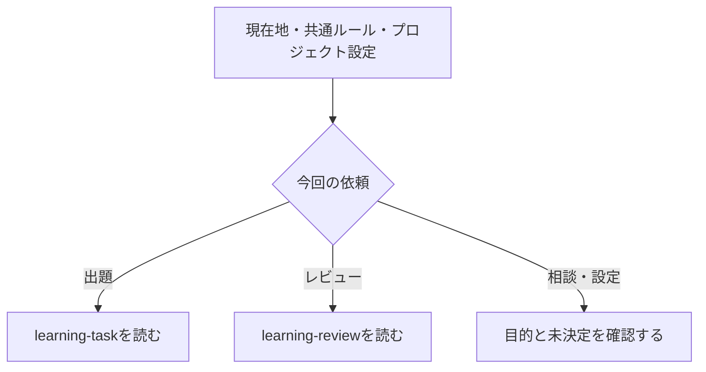

# Claude向けの入口

## 目次

- [読む順序](#読む順序)

- [担当の境界](#担当の境界)

## 読む順序

作業前に[学習計画](docs/plan.md)の現在地、[共通ルール](AGENTS.md)、[プロジェクト設定](docs/project.md)を読む。題材や技術をこの入口で重複定義しない。

出題時は[learning-task](skills/learning-task/SKILL.md)、提出レビュー時は[learning-review](skills/learning-review/SKILL.md)をファイルから読む。これらのスキルのツール側への登録状況は別であり、登録済みとは報告しない。

## 担当の境界

本人の回答・観察結果・学習対象の本番実装は代行しない。未回答を習得済みにせず、ハンズオン完了前に本番の白紙仕様を生成しない。本人の学習用ファイルは修正せず、提出後のレビューで直す場所・手順・確かめ方を伝える。
