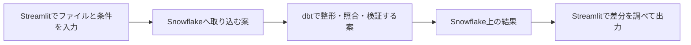
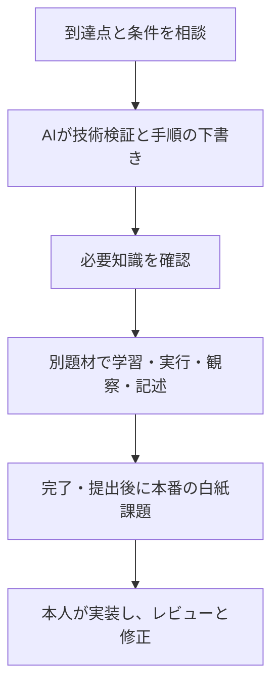

# CSV・Excelの整形・照合ツール

CSV・Excelの一覧を整形し、差分や不備を調べるツールを、自分で仕組みを説明しながら実装できるようになるための学習プロジェクトです。dbt・Snowflakeを使うデータエンジニアとしての成長と、Streamlitの実務的な理解をつなげます。

## 目次

- [現在の状態](#現在の状態)

- [作るものと学習目標](#作るものと学習目標)

- [技術の役割の案](#技術の役割の案)

- [次に確認すること](#次に確認すること)

- [学習の進め方](#学習の進め方)

- [文書と作業場所](#文書と作業場所)

- [用語](#用語)

## 現在の状態

2026-11-13時点で、題材を「CSV・Excelの整形・照合ツール」に決めました。最初に作る範囲と実行環境を相談している段階です。アプリの実装、依存パッケージの導入、技術の実行検証、学習課題の出題はまだ行っていません。

| 項目 | 状態 |
|---|---|
| 題材 | CSV・Excelの整形・照合ツールを本人が選択済み |
| 学習の主軸 | dbt・Snowflakeのデータエンジニアとしての成長と、Streamlitの実務的な理解 |
| 最初の到達点 | 下記のAI案を相談中。MVPは未合意 |
| 実行環境・費用 | Snowflakeの学習用アカウントと課金条件を確認する段階 |
| 採用版・依存管理 | 未選定 |
| アプリ・起動手順 | まだありません |
| 学習課題・理解度 | 未出題・未確認 |

## 作るものと学習目標

最初の到達点のAI案は、同じ種類の一覧を持つ2ファイルを整形し、差分や不備を画面で確認して結果を出力できることです。例えば、新旧の一覧から追加・削除・内容変更を調べる使い方を想定しています。対象の一覧、対応形式、整形ルール、照合方法はこれから相談します。

処理の根拠を説明できること、データの不備や再実行を扱えること、必要な部品を自分で書けることを目指します。最終的にフィリピンの友達の役に立つものを作る目的も継続しますが、このツールを友達が使う具体的な場面は未確認です。

給与予測のアプリは対象から外しています。日本旅行プランは別のReactアプリで検討しています。

## 技術の役割の案

以下は構成案です。具体的な導入方法・版・環境は未決定で、指定環境での動作もまだ検証していません。

| 技術 | 役割の案 | 学ぶこと |
|---|---|---|
| Snowflake | 入力データと処理履歴を保持する | 取り込み、データ型、権限、再実行、クエリと費用 |
| dbt | 整形・照合の処理とデータの検証を管理する | SQLモデル、依存関係、品質テスト、変更管理 |
| Streamlit | ファイル入力、条件設定、結果の調査・出力を提供する | 状態管理、実行タイミング、データ取得、エラーの扱い |

詳細と参考資料は[技術選定](docs/technology.md)と[MVPの検討](docs/mvp.md)に記録します。

## 次に確認すること

1. 学習に使えるSnowflakeアカウントと、費用の条件を確認します。

2. 最初に照合する一覧、対応するファイル形式、小さな到達点を相談します。

3. AIが別題材と指定環境で技術検証し、結果を記録します。

4. 必要な知識を少数ずつ確認してから、教材と課題を用意します。

公開方法、保存条件、画面の言語、学習課題のGit・PR運用は必要な段階で確認します。全項目の決定を開始条件にはしません。

## 学習の進め方

AIは別題材の教材・検証・レビューを担当し、本人が実行、観察、説明、本番の部品の実装を行います。本人の回答や観察記録、本番の解答はAIが代筆しません。

日数やノルマではなく、分野と到達点で区切ります。詳しい担当と参照範囲は[共通ルール](AGENTS.md)を確認してください。

## 文書と作業場所

| 文書 | 役割 |
|---|---|
| [学習計画](docs/plan.md) | 現在地、次の確認、Gitの実施状況 |
| [プロジェクト設定](docs/project.md) | 本人の希望・経験・決定と未決定の条件 |
| [MVPの検討](docs/mvp.md) | 最初の到達点と役割の案 |
| [技術選定](docs/technology.md) | 技術・版・環境と導入方法 |
| [設計メモ](docs/design.md) | 教材と本番の担当の境界、設計判断 |
| [検証記録](docs/verification.md) | 実際に動かした結果と未確認 |
| [弱点記録](docs/weaknesses.md) | 本人の提出を根拠にした学習履歴 |
| [共通ルール](AGENTS.md) | 学習・出題・レビュー・Gitのルール |
| [出題手順](skills/learning-task/SKILL.md) | 知識確認から段階別の出題まで |
| [レビュー手順](skills/learning-review/SKILL.md) | 公開済み基準によるレビュー |
| [ひな形の配布設定記録](docs/template-setup.md) | 元のひな形の記録。今回の作品の学習実績には含めない |

この作業フォルダの接続先は [lovehakumai/muscle_training_streamlit](https://github.com/lovehakumai/muscle_training_streamlit)、文書の同期先は `main` です。学習課題でのPR運用は未決定です。共通ひな形を元にしていますが、このREADMEは今回の作品の入口として更新しています。

## 用語

| 用語 | 平易な説明 |
|---|---|
| 整形 | 表記やデータの形式を処理しやすく揃えること |
| 照合 | 二つの一覧を比べ、対応する内容や違いを確かめること |
| MVP | 最初に動かし、目的に役立つかを確かめる小さな作品 |
| 白紙課題 | 完成コードや解答の雛形を写さず、学んだ技法で本人が実装する課題 |
