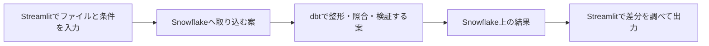
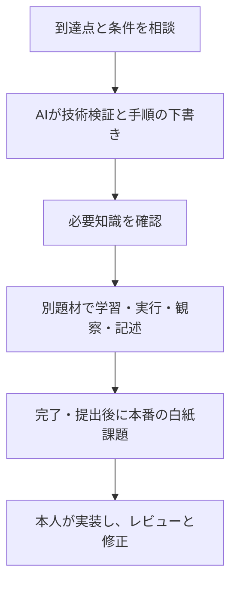

# CSV・Excelの整形・照合ツール

CSV・Excelの一覧を整形し、差分や不備を調べるツールを、自分で仕組みを説明しながら実装できるようになるための学習プロジェクトです。dbt・Snowflakeを使うデータエンジニアとしての成長と、Streamlitの実務的な理解をつなげます。

## 目次

- [現在の状態](#現在の状態)

- [作るものと学習目標](#作るものと学習目標)

- [技術の役割の案](#技術の役割の案)

- [次に確認すること](#次に確認すること)

- [学習の進め方](#学習の進め方)

- [文書と作業場所](#文書と作業場所)

- [用語](#用語)

## 現在の状態

2026-11-13に、題材を「CSV・Excelの整形・照合ツール」に決めました。現在地は2026-11-14に更新しています。最初に作る範囲と実行環境を相談している段階です。本番アプリはまだ実装していません。最初のCSVプレビューについて、別の一時環境でローカル技術検証を行い、知識確認を進めています。ハンズオン教材と白紙課題はまだ公開していません。

| 項目 | 状態 |
|---|---|
| 題材 | CSV・Excelの整形・照合ツールを本人が選択済み |
| 学習の主軸 | dbt・Snowflakeのデータエンジニアとしての成長と、Streamlitの実務的な理解 |
| 最初の到達点 | 下記のAI案を相談中。MVPは未合意 |
| 実行環境・費用 | このMacのローカルから開始。Snowflakeは無料トライアル残高・期限を本人確認済み、課金不可。今回はSnowflake未接続 |
| 採用版・依存管理 | 初回の検証はPython 3.12.0、Streamlit 1.67.0、pandas 3.1.1。独立環境と固定依存で再現する |
| アプリ・起動手順 | まだありません |
| 学習課題・理解度 | [d_01の知識確認](https://github.com/lovehakumai/muscle_training_streamlit/tree/task/d_01/tasks/d_01)を進行中。K01〜K06を受領し、K02・K03は今回の問題の範囲で確認済み。要学習の解説を分け、現在は最後のK07・K08。ハンズオンと白紙は未公開 |

## 作るものと学習目標

最初の到達点のAI案は、同じ種類の一覧を持つ2ファイルを整形し、差分や不備を画面で確認して結果を出力できることです。例えば、新旧の一覧から追加・削除・内容変更を調べる使い方を想定しています。対象の一覧、対応形式、整形ルール、照合方法はこれから相談します。

処理の根拠を説明できること、データの不備や再実行を扱えること、必要な部品を自分で書けることを目指します。最終的にフィリピンの友達の役に立つものを作る目的も継続しますが、このツールを友達が使う具体的な場面は未確認です。

給与予測のアプリは対象から外しています。日本旅行プランは別のReactアプリで検討しています。

## 技術の役割の案

以下は構成案です。具体的な導入方法・版・環境は未決定で、指定環境での動作もまだ検証していません。

| 技術 | 役割の案 | 学ぶこと |
|---|---|---|
| Snowflake | 入力データと処理履歴を保持する | 取り込み、データ型、権限、再実行、クエリと費用 |
| dbt | 整形・照合の処理とデータの検証を管理する | SQLモデル、依存関係、品質テスト、変更管理 |
| Streamlit | ファイル入力、条件設定、結果の調査・出力を提供する | 状態管理、実行タイミング、データ取得、エラーの扱い |

詳細と参考資料は[技術選定](docs/technology.md)と[MVPの検討](docs/mvp.md)に記録します。

## 次に確認すること

1. [d_01の入口](https://github.com/lovehakumai/muscle_training_streamlit/tree/task/d_01/tasks/d_01)から、要学習の解説を読み、最後の知識確認K07・K08へ回答します。K01〜K06は受領済みで、書き直しは不要です。知識確認は採点しません。

2. AIが回答をもとに必要な教材を分け、別題材のハンズオンを用意します。

3. 本人の実行・観察・記述の提出後に、本番の小さな部品の白紙課題へ進みます。

Snowflakeは無料トライアルが使えるという本人の回答を確認済みです。課金不可の条件で、導入する部品の前に残高・期限を再確認します。公開方法、保存条件、画面の言語は必要な段階で相談します。

## 学習の進め方

AIは別題材の教材・検証・レビューを担当し、本人が実行、観察、説明、本番の部品の実装を行います。本人の回答や観察記録、本番の解答はAIが代筆しません。

日数やノルマではなく、分野と到達点で区切ります。詳しい担当と参照範囲は[共通ルール](AGENTS.md)を確認してください。

## 文書と作業場所

| 文書 | 役割 |
|---|---|
| [学習計画](docs/plan.md) | 現在地、次の確認、Gitの実施状況 |
| [プロジェクト設定](docs/project.md) | 本人の希望・経験・決定と未決定の条件 |
| [MVPの検討](docs/mvp.md) | 最初の到達点と役割の案 |
| [技術選定](docs/technology.md) | 技術・版・環境と導入方法 |
| [設計メモ](docs/design.md) | 教材と本番の担当の境界、設計判断 |
| [検証記録](docs/verification.md) | 実際に動かした結果と未確認 |
| [弱点記録](docs/weaknesses.md) | 本人の提出を根拠にした学習履歴 |
| [共通ルール](AGENTS.md) | 学習・出題・レビュー・Gitのルール |
| [出題手順](skills/learning-task/SKILL.md) | 知識確認から段階別の出題まで |
| [レビュー手順](skills/learning-review/SKILL.md) | 公開済み基準によるレビュー |
| [ひな形の配布設定記録](docs/template-setup.md) | 元のひな形の記録。今回の作品の学習実績には含めない |

この作業フォルダの接続先は [lovehakumai/muscle_training_streamlit](https://github.com/lovehakumai/muscle_training_streamlit)、文書の同期先は `main` です。学習課題は `task/d_{NN}` で進め、本人がPRを作成・マージします。共通ひな形を元にしていますが、このREADMEは今回の作品の入口として更新しています。

## 用語

| 用語 | 平易な説明 |
|---|---|
| 整形 | 表記やデータの形式を処理しやすく揃えること |
| 照合 | 二つの一覧を比べ、対応する内容や違いを確かめること |
| MVP | 最初に動かし、目的に役立つかを確かめる小さな作品 |
| 白紙課題 | 完成コードや解答の雛形を写さず、学んだ技法で本人が実装する課題 |
