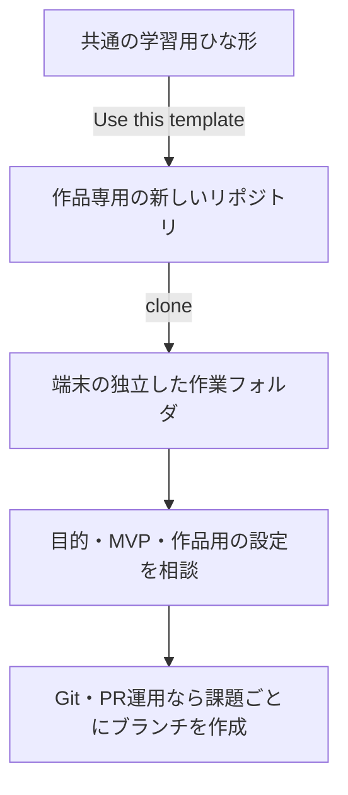
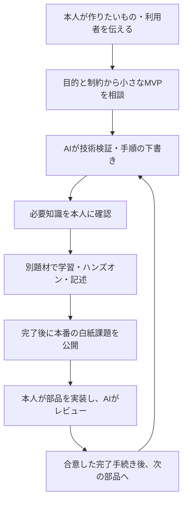

# 作りたいものから学ぶプロジェクト

## 目次

- [このひな形でできること](#このひな形でできること)

- [使い始め方](#使い始め方)

- [ファイルの役割](#ファイルの役割)

- [学習の進め方](#学習の進め方)

- [用語](#用語)

## このひな形でできること

作りたいアプリやツールを題材に、仕組みを説明でき、小さな部品を自分で書けるようになるためのひな形です。別題材の教材で学んだ後、本番で使う最小の作品（MVP）の部品を本人が白紙から実装します。

たとえば読書記録と家計の集計では目的もデータも異なります。それぞれの目的から小さな到達点を決め、同じ学習の流れを使えます。完成例や出題済み課題は含めていません。

元のプロジェクトのコード・提出物・学習実績・検証結果・Git接続先は持ち込んでいません。技術や費用などの条件は、新しいプロジェクトで決めます。ひな形を配布するリポジトリのGit設定と、作品ごとのGit設定・学習実績は区別します。

## 使い始め方

1. 本人が、GitHubのひな形リポジトリで `Use this template` → `Create a new repository` を選び、作品専用のリポジトリを作ります。通常は既定のブランチだけを使い、`Include all branches` は選びません。

2. 本人が、作成した作品専用リポジトリを自分の端末へcloneし、そのフォルダをエディタとAIの作業ルートとして開きます。ひな形や別の作品のフォルダの外に置きます。

3. 本人が、作りたいもの・誰の何を助けたいか・最初にできたらうれしいことをAIに伝えます。[プロジェクト設定](docs/project.md)は、AIと相談して埋めてよく、最初に全項目を埋める必要はありません。

4. AIが、目的と制約を整理し、小さなMVPの候補を比較・検証します。本人と到達点を確認した後、今回必要な知識を確認します。

開始時には、次のように依頼できます。これはAIへの作業依頼の例で、課題の回答ではありません。

```text
README.md、AGENTS.md、docs/plan.mdを読んで、このひな形で学習を始めてください。
まず、作りたいものと利用者を私に確認してください。
未決定の技術や条件を確定済みにせず、小さなMVPの候補から相談してください。
```

このフォルダのまま元のリポジトリ内で参照する場合は、独立した学習プロジェクトが始まったとは扱いません。課題の新規作成とGit操作は、コピー先のルートと設定を確認してから行います。

GitHubを使わず、このフォルダ全体を新しい作業場所へコピーして始めることもできます。その場合も元の `.git` はコピーせず、Gitを使うかどうかを作品ごとに相談します。



テンプレートから作成したリポジトリは、新しい履歴で始まります。forkは元との関係を保つ別リポジトリ、ブランチは同じリポジトリ内の作業の分岐です。作品ごとにリポジトリを分け、その中で課題ごとに `task/d_{NN}` を使います。公式の手順は[GitHubのテンプレートからの作成](https://docs.github.com/en/repositories/creating-and-managing-repositories/creating-a-repository-from-a-template)を参照してください。

作品用の [プロジェクト設定](docs/project.md) と [学習計画](docs/plan.md) は未設定の状態から始めます。ひな形のアップロードを、作品のcommit・push・課題の完了として記録しません。

## ファイルの役割

| ファイル | 内容 | 更新する場面 |
|---|---|---|
| [AGENTS.md](AGENTS.md) | 題材によらない学習・出題・レビューの共通ルール | 本人が学習方法の変更を依頼したとき |
| [CLAUDE.md](CLAUDE.md) | Claudeから共通ルールを読む入口 | 参照先を変えたとき |
| [プロジェクト設定](docs/project.md) | 目的、利用者、費用、技術の条件、言語、Gitの設定 | 本人と条件を確認したとき |
| [学習計画](docs/plan.md) | 現在地、部品ごとの到達点、Gitの実施状況 | 段階が進んだとき |
| [MVPの検討](docs/mvp.md) | 理想の分解、候補比較、最初に作る範囲 | 到達点を決めるとき |
| [技術選定](docs/technology.md) | 候補、公式根拠、採否、版、安全性、環境の操作 | 技術を導入する回 |
| [設計メモ](docs/design.md) | 本人の決定、教材と本番の境界、未決定 | 設計を確認したとき |
| [検証記録](docs/verification.md) | 実際に動かした環境・入力・コマンド・出力 | 実行検証したとき |
| [弱点記録](docs/weaknesses.md) | 提出を根拠にした未学習と繰り返す弱点 | レビューしたとき |
| [出題スキル](skills/learning-task/SKILL.md) | 知識確認から段階ごとの出題までの手順 | AIが出題するときに読む |
| [レビュースキル](skills/learning-review/SKILL.md) | 公開済み基準による評価と記録の手順 | AIがレビューするときに読む |
| [ひな形の配布設定記録](docs/template-setup.md) | このひな形自体のGitHub登録結果。作品の学習実績には含めない | ひな形の配布設定を変更したとき |

スキルはファイルとして参照できます。AIツールのスキル一覧への登録は行っていません。自動検出の有無にかかわらず、出題・レビュー時にはAGENTS.mdの参照先から読みます。

## 学習の進め方



分数や日数ではなく、学習分野と到達点で区切ります。白紙は「解答コードや雛形なしで本人が書く」という意味で、暗記は求めません。資料を参照できる範囲は[共通ルール](AGENTS.md)に記載しています。

## 用語

| 用語 | 平易な説明 |
|---|---|
| リポジトリ | ファイルと変更履歴を管理する入れ物 |
| テンプレート | 共通のファイル構成から、新しい作品を始めるためのひな形 |
| clone | リポジトリを履歴とともに自分の端末へ取得する操作 |
| ブランチ | 同じリポジトリ内で作業を分ける仕組み |
| commit・push | 変更を履歴に保存する操作と、その履歴をGitHubなどへ送る操作 |
