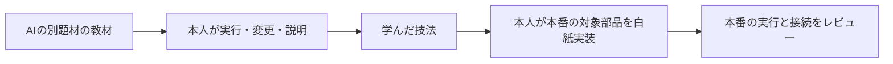

# 設計と担当の境界

## 目次

- [現在の決定](#現在の決定)

- [教材と本番](#教材と本番)

- [判断の記録](#判断の記録)

## 現在の決定

作品の設計は未決定。作るもの・利用者・制約は[プロジェクト設定](project.md)、今回の到達点は[MVPの検討](mvp.md)で確認する。AIの検証用実装を本人の設計や学習成果として記録しない。

## 教材と本番

| 配置 | 用途 | 担当と制限 |
|---|---|---|
| `tasks/d_{NN}/handson/` | 本番と異なる用途・データの教材 | AIが用意し、本人が実行・変更する。本番へ流用しない |
| `tasks/d_{NN}/submit/` | 回答と参照・操作・観察の記録 | 本人が書く。AIは変更しない |
| `tasks/d_{NN}/practice/` | ハンズオン完了後の白紙仕様と採点表 | AIが完了・提出の確認後に作る。解答や雛形は置かない |
| 本番コードの配置先 | 本人が白紙で実装する部品 | 配置先は未設定。技術選定後、課題で新規パスを指定する |
| 独立した一時領域 | AIによる本番要件の実現性検証 | 本番・教材・提出領域に置かず、解答として本人へ公開しない |

2026-11-16、task/d_01ブランチの `tasks/d_01/handson/` に別題材の教材を作成した。観測CSVを読むCLIと、メモのバイト数・状態・例外を扱う画面を分けており、本番のCSVアップロードから表表示までを完成させたものではない。submitにはAIが本人の回答・観察結果を作成せず、保存場所だけ用意した。practiceと本番コードはまだ作成していない。本人が書く関数・型・処理の解答骨格を先に作らない。練習対象外の環境や表示部品だけAIが用意できる。

この矢印は技法の応用を表す。教材の完成コードのコピーや、名前だけの置換を表すものではない。

## 判断の記録

設計判断の記録はまだない。決定時には、対象の部品・判断内容・本人の決定かAIの提案か・根拠・確認日を残す。提出前の本人に求めた判断は、本人の提出後に原文を参照して記録する。

データの形や境界を決める回では、1件の単位・ID・値の由来・型・空や欠けた値・順序・再実行を必要な範囲で整理する。作品全体の完成スキーマを先に作らない。
