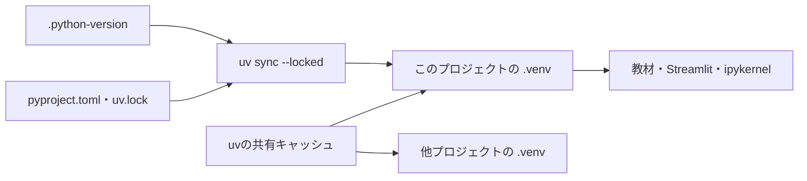
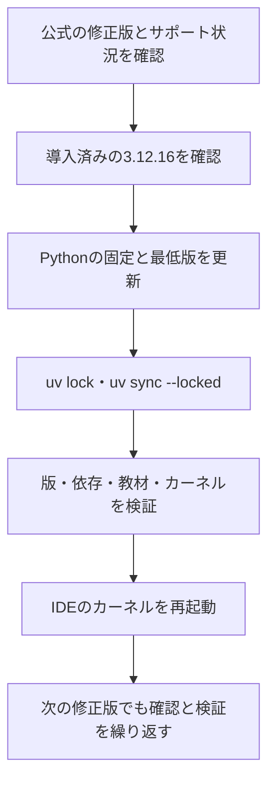
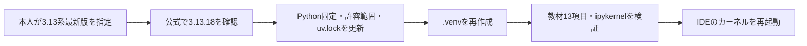

# uvで管理するローカル環境

## 目次

- [構成と選定](#構成と選定)

- [使い方](#使い方)

- [AIの実測](#aiの実測)

- [Pythonのセキュリティ更新](#pythonのセキュリティ更新)

- [Python 3.13系への移行](#python-313系への移行)

- [確かめていないこと](#確かめていないこと)

- [用語](#用語)

## 構成と選定

2026-11-16、本人がuvでのパッケージ管理と既存の共有キャッシュ利用を希望し、特にipykernelを必要とした。学習対象外の環境設定としてAIが移行した。既存Python 3.12.0と、Streamlit 1.67.0・pandas 3.1.1を含む既存33パッケージの版を維持した。

その後、本人から3.12.0のセキュリティへの懸念を受け、AIが古いPythonを固定した設定を修正した。さらに本人が3.13系の最新版を希望したため、現在はuv管理Python 3.13.18を使用する。初回と3.12.16の実測は過去の事実として保持し、現在の実測は[Python 3.13系への移行](#python-313系への移行)に記録する。

このMacの `uv cache dir` は `/Users/uramasaharu/.cache/uv` を返す。同じ設定で動く他プロジェクトと取得済みパッケージを再利用できる。必要な版や配布物がなければuvが取得する。Pythonの実行環境はプロジェクトごとの `.venv` に分かれるので、他プロジェクトにipykernelを追加する操作にはならない。

| 候補 | 依存を再現する方法 | 採否・引き受ける不便 |
|---|---|---|
| uvのプロジェクト管理 | `pyproject.toml`・`uv.lock` と `uv sync` | 採用。通常依存と開発用依存を分け、追加・実行をuvに揃える。新しい操作を使う |
| uvのpip互換操作 | requirementsと `uv pip sync` | 従来方式。共有キャッシュは使えるが、依存追加・固定の操作を別々に管理する |
| 他プロジェクトの仮想環境を使う | 既存環境に依存する | 不採用。プロジェクト間でパッケージの変更が影響するため、独立環境の条件に合わない |

| 管理対象 | 役割 |
|---|---|
| `pyproject.toml` | 通常依存をStreamlit・pandas、開発用依存をipykernel 7.4.0として宣言。配布パッケージのビルドは行わない |
| `uv.lock` | 間接依存も含め、版・取得元・ハッシュを固定 |
| `.python-version` | 使用するPythonを3.13.18に指定。`pyproject.toml` の許容範囲は `>=3.13.18,<3.14` |
| `.venv` | このプロジェクトのPython実行環境。Git対象外 |
| uvの共有キャッシュ | ダウンロード・展開済み配布物などを再利用。プロジェクト内へのコピーや専用キャッシュ設定は不要 |



ipykernelはNotebookやIDEからPythonを動かす実行役なので、開発用依存にした。7.4.0の公式メタデータはPython 3.11以上、ライセンスはBSD-3-Clause。公式PyPIでは2026-09-29のリリースを確認した。2026-11-16に公式アドバイザリ一覧を閲覧した時点では公開項目はなかった。追加依存全体の脆弱性照会は今回実施していない。

公式根拠（2026-11-16確認）：[uvのキャッシュ](https://docs.astral.sh/uv/concepts/cache/)、[依存管理](https://docs.astral.sh/uv/concepts/projects/dependencies/)、[Jupyter・VS Code連携](https://docs.astral.sh/uv/guides/integration/jupyter/)、[ipykernel 7.4.0のメタデータ](https://pypi.org/project/ipykernel/7.4.0/)、[公式アドバイザリ](https://github.com/ipython/ipykernel/security/advisories)。ローカルのパッケージ導入であり、有料サービスの利用や課金操作はない。

## 使い方

このプロジェクトのルートで実行する。環境操作は学習の採点対象にしない。

1. 固定された通常依存と開発用依存を `.venv` に揃える。

   ```sh
   uv sync --locked
   ```

2. Pythonの場所と版を確認する。

   ```sh
   uv run --locked python -c 'import sys, ipykernel; print(sys.executable); print(ipykernel.__version__)'
   ```

3. VS Codeではコマンドパレットの `Python: Select Interpreter` から、このフォルダの `.venv/bin/python` を選ぶ。Notebookのカーネル選択は `Select Kernel` → `Python Environments` → 同じ `.venv/bin/python`。Interactive Windowでもカーネルとしてこの環境を選ぶ。これは本人が操作する。共有キャッシュ内のパスをインタープリターとして指定しない。

通常の教材コマンドで使っている `.venv/bin/python` も引き続き利用できる。今後の通常依存追加は `uv add パッケージ名`、開発用追加は `uv add --dev パッケージ名`。いずれも `pyproject.toml`・`uv.lock`・`.venv` を更新する。`uv run --locked` は固定内容でコマンドを実行する。Pythonから終了する場合は通常の実行は終了まで待ち、常駐するカーネルはIDEの停止操作を使う。

`uv sync --locked` がロックの不一致を報告したら、エラーを共有する。宣言した依存を意図して変更した場合は `uv lock` で固定結果を更新し、差分を確認してから同期する。`uv sync` は宣言されていないパッケージを環境から除くため、継続して使う依存は `uv add` で記録する。

## AIの実測

| 項目 | 入力・コマンドと結果 |
|---|---|
| 日付・場所・環境 | 2026-11-16、このMacのプロジェクトルート。uv 0.13.7、CPython 3.12.0、既存 `.venv` |
| キャッシュの場所 | `uv cache dir` → `/Users/uramasaharu/.cache/uv` |
| 移行 | 通常依存を `pyproject.toml` に記載後、`uv add --dev ipykernel --bounds exact --constraints requirements.lock --python /usr/local/bin/python3 --no-python-downloads` → 64パッケージを解決、26パッケージを追加。pyzmqのダウンロードを表示。旧固定ファイルは移行後に削除 |
| 再同期 | `uv sync --locked --no-python-downloads` → `Resolved 64 packages`、`Checked 59 packages`、終了コード0。ロックには他OS用依存も含むため、導入数とは異なる |
| 整合性 | `uv pip check --python .venv/bin/python` → `All installed packages are compatible`、終了コード0 |
| 既存依存・本人の編集の保持 | `.venv/bin/python -c ...` で移行前後のimportlib.metadataとSHA-256を比較 → `Existing dependency changes: {}`、`reading_lab unchanged: True` |
| カーネル | `.venv/bin/python -` にAIの検証処理を標準入力で渡した。jupyter_clientのKernelManagerで `/private/tmp` の一時ディレクトリに起動し、主要依存のimportと `6 * 7` を実行 → `.venv/bin/python` の絶対パス、`7.4.0 3.1.1 1.67.0`、`42`、`Kernel status: ok`、`Kernel stopped: True`。終了コード0 |
| 実行時メッセージ | 依存解決時、古い版指定をuvが補正するWARNが出た。カーネルはローカルTCPの暗号化なしのWARNINGを表示。両処理とも正常終了した |

AI実行の環境確認であり、本人のハンズオン操作や観察記録には算入しない。学習用コードや本人の記録は変更していない。

## Pythonのセキュリティ更新

2026-11-16、`uv run python --version` が3.12.0だった原因は、AIが `.python-version` にその版を固定したことだった。uv管理の3.12.16はすでにこのMacに導入されていた。uvでパッケージを同期しても、固定したPythonが自動で最新の修正版になるわけではない。

公式の3.12.16は2026-10-25のセキュリティリリース。3.12系は2028年10月までセキュリティ修正の提供対象だが、3.12.0に後続の修正が自動で入る意味ではない。実際の影響は使用する機能・入力・配布元の修正にも依存するが、この環境では修正版を使用する。公式根拠（2026-11-16確認）：[Python 3.12.16](https://www.python.org/downloads/release/python-31216/)、[Pythonのサポート状況](https://devguide.python.org/versions/)、[uvのPython管理](https://docs.astral.sh/uv/concepts/python-versions/)。uv管理のCPythonはAstralのpython-build-standaloneによる配布物を使用する。

| 候補 | 修正・互換性の比較 | 採否と引き受ける不便 |
|---|---|---|
| 3.12.0を固定し続ける | 後続のセキュリティ修正を取り込めない | 不採用 |
| 3.12.16へ更新する | 同じ3.12系で修正を取り込め、既存依存への影響を抑えられる | 採用。仮想環境の再作成とIDEのカーネル再起動が必要 |
| 3.13以降へ更新する | 新機能・保守期間の利点があるが、依存と教材の互換性を別途確認する必要がある | この比較時点では見送り。その後、本人の指定で3.13.18を採用。次節参照 |

`.python-version` は3.12.16、`requires-python` は `>=3.12.16,<3.13` に更新した。Pythonの選択と依存の許容範囲の両方で3.12.0への復帰を防ぐ。旧システムPythonや他プロジェクトの設定は今回変更していない。



| 操作・入力 | 実測結果 |
|---|---|
| `uv python list 3.12 --all-versions` | uv管理の3.12.16と旧システム3.12.0の両方を確認 |
| `uv lock --offline --no-python-downloads` | 他OS用watchdogのメタデータ不足で失敗。オンラインでの次の操作へ切り替えた |
| `uv lock --no-python-downloads` | CPython 3.12.16を使用、64パッケージを解決、終了コード0 |
| `uv sync --locked --no-python-downloads` | `.venv` を3.12.16で再作成、59パッケージを導入、終了コード0 |
| `uv run --locked python --version` | `Python 3.12.16`、終了コード0 |
| `uv pip check --python .venv/bin/python` | `All installed packages are compatible`、終了コード0 |
| 移行前後の依存・コード比較 | importlib.metadataによる59パッケージの名前・版の一致、本人の編集中reading_lab.pyのSHA-256一致 |
| 教材の検証 | `.venv/bin/python /private/tmp/muscle-python31216-d2vejyua/verify.py` → 13項目PASS。CLIはHEADの元の教材を一時コピーして使用。結果は同ディレクトリのresults.json・stdout.txt・stderr.txtに保存 |
| 検証起動の修正 | 最初の補助処理では `.venv/bin/python` のシンボリックリンクを解決して直接実行したため、仮想環境を経由せずStreamlitのimportに失敗。上記の `.venv/bin/python` で再実行して成功した |
| 一時カーネル | `.venv/bin/python -` へAIのKernelManager検証を渡し、Pythonの版をassertしてimportと `6 * 7` を実行 → `3.12.16 7.4.0 3.1.1 1.67.0`、`42`、`Kernel stopped: True`、終了コード0。ローカルTCPの暗号化なしのWARNINGは更新前と同じ |

今後もPythonの固定は更新が必要。修正版を採用する際は公式情報を確認し、`uv python install --no-bin <修正版>`、`uv python pin <修正版>`、`requires-python` の最低版更新、`uv lock`、`uv sync --locked`、動作確認の順に行う。`uv.lock` はPython本体を固定するファイルではなく、`uv sync --locked` だけではPythonの固定版を更新しない。

本人のIDEでは、起動中のNotebook・Interactive Windowのカーネルを停止し、プロジェクトの `.venv/bin/python` を選び直して起動する。実行中の古いPythonプロセスは、ファイルの更新だけでは新しいPythonに切り替わらない。

## Python 3.13系への移行

2026-11-16、本人が「Python 3.13系の最新」を指定した。[Python公式の版一覧](https://www.python.org/doc/versions/)と[3.13.18のリリース情報](https://www.python.org/downloads/release/python-31318/)で、3.13系の最新安定版が2026-10-25公開の3.13.18であることを確認した。同版はこのMacのuv管理領域に導入済みだった。通常のCPythonを選び、free-threaded版は導入していない。

`.python-version` を3.13.18、`requires-python` を `>=3.13.18,<3.14` に変更した。既存のStreamlit・pandas・ipykernelを含む59パッケージはすべて同じ版で利用できた。Python 3.13用の配布物が必要なパッケージは共有キャッシュを通じて取得した。



| 操作・入力 | 実測結果 |
|---|---|
| `uv python list 3.13 --all-versions` | uv管理のCPython 3.13.18を導入済みとして表示 |
| `uv lock --no-python-downloads` | Python許容範囲の変更に伴う再解決を通知。CPython 3.13.18で64パッケージを解決、終了コード0 |
| `uv sync --locked --no-python-downloads` | `.venv` を3.13.18で再作成し59パッケージを導入、終了コード0 |
| `uv run --locked python --version` | `Python 3.13.18`、終了コード0 |
| `uv pip check --python .venv/bin/python` | `All installed packages are compatible`、終了コード0 |
| 教材の検証 | `.venv/bin/python` から一時検証を実行。HEADの元のCLI教材を使った13項目がPASS。処理・結果は `/private/tmp/muscle-python31318-zfic2ue4/` のverify.py・results.json・stdout.txt・stderr.txtに保存 |
| 依存と本人の編集の比較 | importlib.metadataで59パッケージの名前・版が一致。編集中reading_lab.pyのSHA-256が一致 |
| 一時カーネル | `.venv/bin/python -` にKernelManager検証を渡し、Pythonの版をassertして主要依存のimportと計算を実行 → `3.13.18 7.4.0 3.1.1 1.67.0`、`42`、`Kernel stopped: True`。終了コード0。ローカルTCPのWARNINGは前回と同じ |

以後の修正版も3.13系で公式情報を確認して更新する。通常の再現は `uv sync --locked`。IDEでは既存カーネルを停止し、このプロジェクトの `.venv/bin/python` を選んで起動し直す。

## 確かめていないこと

| 対象 | いつ | 誰が・何を動かすか |
|---|---|---|
| IDEの実際のカーネル選択 | IDEで使うとき | 本人が上の手順で `.venv/bin/python` を選び、セルを実行 |
| 別Mac・他OSでの再現 | 別環境へ移すとき | その環境の利用者が `uv sync --locked` と版確認を実行 |
| 追加した依存全体の脆弱性照会 | 依存の安全性を再点検するとき | AIが固定した追加パッケージ名・版で公式情報を確認 |

## 用語

| 用語 | 平易な説明 |
|---|---|
| 共有キャッシュ | 一度取得したパッケージなどを別の導入でも再利用する保管場所 |
| 仮想環境 | プロジェクトごとにPythonとパッケージを分けて使う場所 |
| 開発用依存 | アプリの利用時よりも、開発・調査・学習の操作で必要なパッケージ |
| カーネル | Notebookなどから渡されたコードを実行するPythonのプロセス |
| ロックファイル | 実際に使う依存の版や取得元を記録し、同じ構成を再現するファイル |
