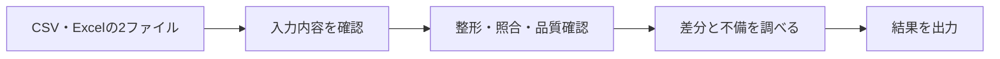
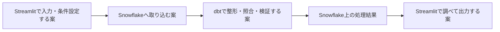

# 最初に作る小さな作品の検討

## 目次

- [本人が選んだ題材](#本人が選んだ題材)

- [最初の到達点の案](#最初の到達点の案)

- [役割と学習のつながり](#役割と学習のつながり)

- [未確認と次の確認](#未確認と次の確認)

- [用語](#用語)

## 本人が選んだ題材

2026-11-13、本人が「CSV・Excelの整形・照合ツール」を選択した。将来の主軸であるdbt・Snowflakeのデータエンジニアとしての学習と、Streamlitの実務的な理解をつなぐ。最終的にフィリピンの友達に役立つものを作る目的は継続するが、このツールを友達が使う具体的な用途は未確認。

給与案は既存機能とインタビュー負担を理由に除外済み。日本旅行プランは別のReactアプリで検討。通信品質分析や稼働分析などは未採用。常に最新情報を案内するだけの題材より、手元のデータに対して処理を繰り返し、結果を検証できる用途を希望している。

## 最初の到達点の案

題材の選択は確認済みだが、MVPは未合意。以下は利用者ができることを相談するAI案であり、本番のデータ設計・実装手順・白紙課題の仕様や採点基準ではない。

最初の到達点のAI案は、同じ種類の一覧を持つ2ファイルを整形し、差分や不備を画面で確認して、結果を出力できること。架空データで最初の利用場面を確かめる案とし、友達や会社への業務インタビューを開始条件にしない。

| 利用者の操作の案 | できることの案 | 最初の範囲を決める時の確認 |
|---|---|---|
| 2ファイルを読み込む | 内容をプレビューして比較対象を確認する | CSVとExcelの対応形式、シートの扱い、対象の一覧 |
| 整形と照合を実行する | 表記・型の違いを揃え、不備や一致しない内容を確認する | 適用するルール、どの項目で同じ対象と判断するか、任意の列に対応する範囲 |
| 結果を調べて出力する | 元データと結果を照らし、必要な差分を取り出す | 修正機能、出力形式、履歴をどこまで扱うか |

高度な自動推定や曖昧な名前の名寄せ、大量のファイル形式への対応、全ての列構造への対応は最初の必須条件として合意していない。対象を一種類の一覧に絞る案から検討する。CSV・Excel双方を題材とした希望と、最初の部品で扱う形式は区別し、対応形式を本人と相談する。

## 役割と学習のつながり

以下は構成のAI案。処理を全て画面内で完結させず、データの保存と変換・検証、利用者の操作に役割を持たせて学ぶ。具体的な技術導入と環境の決定は未実施。

| 技術 | 役割の案 | 学べる分野 |
|---|---|---|
| Snowflake | 入力データと処理の履歴を保持し、照合対象を扱う | データの取り込み、粒度と型、権限、再実行、クエリと費用 |
| dbt | 共通の整形・照合をモデルとして管理し、データをテストする | SQL変換、依存関係、欠損・重複等の品質検証、変更管理 |
| Streamlit | ファイル入力、条件設定、結果の詳細確認、出力を提供する | 状態管理、実行タイミング、接続、エラーの扱い、結果の検証 |

2026-11-13参照：[Snowflakeのデータ取り込み](https://docs.snowflake.com/en/user-guide/data-load-overview)、[dbtのSQLモデル](https://docs.getdbt.com/docs/build/sql-models)、[dbtのデータテスト](https://docs.getdbt.com/docs/build/data-tests)、[Streamlitの表の表示と編集](https://docs.streamlit.io/develop/concepts/design/dataframes)。機能の参考であり、今回の指定環境での実行結果ではない。ファイル取り込みや利用者ごとの条件をdbtにつなぐ具体的な方法は、別題材で検証してから選定する。

## 未確認と次の確認

| 未確認 | 確認時点 | 担当と操作 |
|---|---|---|
| Snowflakeの実行環境での確認 | Snowflakeを導入する部品の前 | 本人は無料トライアル残高・期限を確認済みで課金不可。今回AIは未接続。導入時に無料で使える状態を改めて確認して必要最小限を検証 |
| 最初に照合する一覧と到達点 | MVPの合意前 | AIが架空の一覧の利用場面を提案し、本人と相談 |
| 入力形式、整形・照合とdbtのつなぎ方 | MVPの最終合意前 | AIが指定環境・別題材で正常・必要な境界・失敗時を検証 |
| 表示言語、保存・公開条件 | 関連する実装前 | Gitは課題別ブランチと本人によるPR作成・マージを選択済み。他の必要な項目を本人と確認 |
| 必要知識と本人の理解 | 技術検証と手順の下書き後 | 少数ずつ確認。経験の自己申告を習得確認に置き換えない |

最初は先に提案した単一CSVの内容確認を一分野として準備する。2026-11-13、ローカルで実現性の19項目と起動・停止を確認した。Snowflakeやdbtの接続・実行を確認した結果ではない。2026-11-16に知識確認8項目を全て受領し、要学習を反映した別題材のハンズオンS01・S02・W01を公開した。本人の実行・変更・観察・記述を確認してから、最初の部品の白紙仕様を公開する。MVP全体の詳細、全課題、本番の完成コードは先に作らない。

## 用語

| 用語 | 平易な説明 |
|---|---|
| MVP | 最初に動かし、目的に役立つかを確かめる小さな作品 |
| 整形 | 表記やデータの形式を処理しやすく揃えること |
| 照合 | 二つの一覧を比べ、対応する内容や違いを確かめること |
| データテスト | 重複や欠損など、データが決めた条件を満たすか確かめること |
| 名寄せ | 表記が異なる情報が同じ対象を指すか判断してまとめること |
