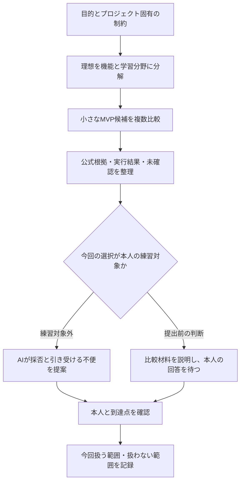

# 最初に作る小さな作品の検討

## 目次

- [理想を分ける](#理想を分ける)

- [候補を比較する](#候補を比較する)

- [今回の到達点](#今回の到達点)

## 理想を分ける

現在は作るものが未設定。[プロジェクト設定](project.md)の目的と利用者から、理想の機能を学習分野へ分解する。理想の機能をすべて今回の必須条件にしない。

整理するときは「利用者ができること・必要な知識と技能・他の作品での再利用・前提となる知識・今回扱うか」を表にする。題材が変わっても、先に必要な知識を洗い出す進め方を使う。

## 候補を比較する

候補は未作成。目的に届く小さな到達点を複数挙げ、学習上の貢献・早く動くものになるか・本人の費用条件・環境と追加負担・検証結果を比較する。

AIが実現性を最小限の実行で確認する。実測の詳細は[検証記録](verification.md)へ、技術の根拠は[技術選定](technology.md)へ記録する。未実行は未確認とし、次の確認時期と実施者を明記する。

## 今回の到達点

MVPは未決定。合意後に「本人が選んだ到達点・今回含める機能・今回含めない機能・完成を確かめる方法・確認日と根拠」を記録し、[学習計画](plan.md)の部品表につなぐ。

全体の到達点の合意と、後で出す白紙課題の具体的な仕様は区別する。ハンズオン完了前に、本番の解答・データ設計・白紙課題の詳細を先に生成しない。
