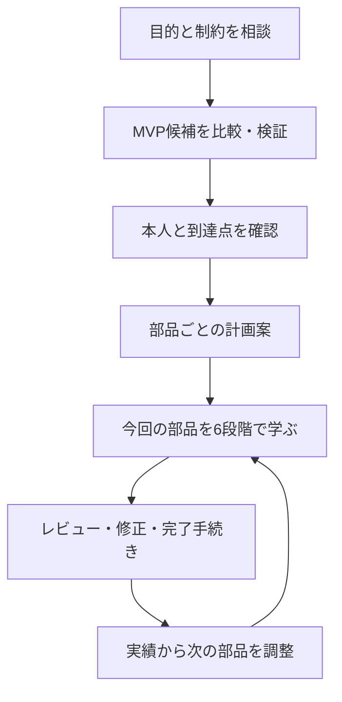

現在地：2026-11-13、本人がCSV・Excelの整形・照合ツールを題材に選択。dbt・Snowflakeを主軸に、Streamlitのファイル入力・条件設定・結果調査とつなぐMVP候補を整理中。具体的な利用場面・最初の到達点・費用・環境は未合意。課題は未出題、本人の知識と学習時のGit・PR運用は未確認。READMEを今回の作品向けに更新し、設定文書とともにmainへ同期する作業を実施。

# 学習計画

## 目次

- [開始条件](#開始条件)

- [部品ごとの計画](#部品ごとの計画)

- [完了と次の部品](#完了と次の部品)

- [Gitと実施状況](#gitと実施状況)

## 開始条件

本人と[プロジェクト設定](project.md)を相談し、[MVPの検討](mvp.md)で小さな到達点を選ぶ。最初から全機能の実装計画や全回の課題を作らない。

分野と到達点で区切り、複数日で取り組める分量にする。次の回の番号や分割は、本人と確認するまでは提案として扱う。

## 部品ごとの計画

まだ課題はない。MVP合意後に「課題ID・学習分野・別題材・本番の対象部品・到達点・開始条件・現在の段階」を記録する。白紙課題の具体的な仕様と採点表は、当該ハンズオンの完了・提出後に生成する。

本人の理解は、各課題の `knowledge.md` に根拠付きで記録する。未学習の技法は次の部品でも使い、難度を上げない。未学習が3つ以上たまったら新しい部品へ進まず復習する。

## 完了と次の部品

ハンズオン・記述・本番の白紙実装を別々に確認する。教材が動いたことだけを本番や理解の成功としない。各段階の合否は公開済み基準で判定し、今回の完成条件に理想の全機能を加えない。

Git・PR運用では、レビューと修正後に本人がPRをマージしてから次の課題を出す。同じ課題のハンズオンから白紙への移行は次課題と区別する。Gitを使わない場合は、本人と合意した提出固定・完了方法を使う。

## Gitと実施状況

| 項目 | 現在の状態 |
|---|---|
| 運用方式の選択 | Gitは使用中。今回のドキュメント同期先はmain。学習課題でのPR運用は未決定 |
| 独立したコピー先の確認 | 2026-11-12、本人指定の作業ルート `/Users/uramasaharu/Documents/develop/muscle_training_streamlit` が空で、親のGitリポジトリ内ではないことを確認後にclone |
| Git初期化・既存リポジトリの確認 | 2026-11-12、本人の依頼によりclone完了。取得時のHEADは `129c9d0`、ブランチは `main`、未コミット差分なし |
| リモートと基準ブランチの設定 | clone結果：`origin` は `https://github.com/lovehakumai/muscle_training_streamlit.git`、`main` は `origin/main` を追跡。学習時の基準ブランチとPR運用は未合意 |
| 課題ブランチの作成 | 未実施 |
| commit・push | 今回の対象はREADMEとプロジェクト設定・MVP・学習計画・技術選定の5文書。mainからorigin/mainへ同期する。操作完了はGit履歴とリモート参照の一致で確認し、学習課題の完了には数えない |
| PR作成・マージ | 未実施 |

元のプロジェクトのGit状態や履歴はこの表へ転記しない。実際の操作後に、対象ルート・ブランチ・コミットなどの根拠を記録する。
