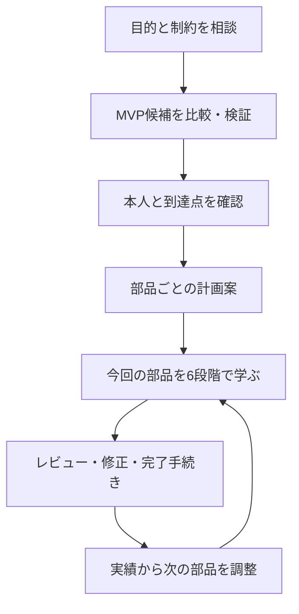

現在地：2026-11-13、最初のCSVプレビューのローカル技術検証19項目とサーバーの起動・停止を確認。次はd_01の知識確認。Snowflakeは無料トライアルの残高・期限を本人が確認済み、課金不可。今回の検証ではSnowflake未接続。共通文書はmain、課題はtask/d_01で進める。ハンズオンと白紙仕様は未公開、MVP全体の詳細は引き続き相談する。

# 学習計画

## 目次

- [開始条件](#開始条件)

- [部品ごとの計画](#部品ごとの計画)

- [完了と次の部品](#完了と次の部品)

- [Gitと実施状況](#gitと実施状況)

## 開始条件

本人と[プロジェクト設定](project.md)を相談し、[MVPの検討](mvp.md)で小さな到達点を選ぶ。最初から全機能の実装計画や全回の課題を作らない。

分野と到達点で区切り、複数日で取り組める分量にする。次の回の番号や分割は、本人と確認するまでは提案として扱う。

## 部品ごとの計画

最初の部品は、先に提案した「CSVを読み、元の値を保って内容を確認する」の準備を進める。MVP全体の詳細と、本番の具体的な白紙仕様はまだ確定しない。

| 課題ID | 学習分野 | 別題材の案 | 本番の対象部品の案 | 到達点 | 現在の段階 |
|---|---|---|---|---|---|
| d_01 | CSVの値・型・欠損とStreamlitの再実行 | 観測記録をCLIで読む練習と、別のカウンター画面の実行順を調べる練習 | 単一CSVの内容確認 | 入力値を勝手に変えないことと、操作時の再実行を説明できる | ローカル技術検証済み、知識確認を用意。ハンズオン未公開 |

読む入口は[task/d_01の資料](https://github.com/lovehakumai/muscle_training_streamlit/tree/task/d_01/tasks/d_01)。課題資料は課題ブランチに置く。白紙課題の具体的な仕様と採点表は、当該ハンズオンの完了・提出後に生成する。

本人の理解は、各課題の `knowledge.md` に根拠付きで記録する。未学習の技法は次の部品でも使い、難度を上げない。未学習が3つ以上たまったら新しい部品へ進まず復習する。

## 完了と次の部品

ハンズオン・記述・本番の白紙実装を別々に確認する。教材が動いたことだけを本番や理解の成功としない。各段階の合否は公開済み基準で判定し、今回の完成条件に理想の全機能を加えない。

Git・PR運用では、レビューと修正後に本人がPRをマージしてから次の課題を出す。同じ課題のハンズオンから白紙への移行は次課題と区別する。Gitを使わない場合は、本人と合意した提出固定・完了方法を使う。

## Gitと実施状況

| 項目 | 現在の状態 |
|---|---|
| 運用方式の選択 | 共通文書はmainへ同期。課題はtask/d_{NN}で進め、本人がPRを作成・マージする（2026-11-13選択） |
| 独立したコピー先の確認 | 2026-11-12、本人指定の作業ルート `/Users/uramasaharu/Documents/develop/muscle_training_streamlit` が空で、親のGitリポジトリ内ではないことを確認後にclone |
| Git初期化・既存リポジトリの確認 | 2026-11-12、本人の依頼によりclone完了。取得時のHEADは `129c9d0`、ブランチは `main`、未コミット差分なし |
| リモートと基準ブランチの設定 | clone結果：`origin` は `https://github.com/lovehakumai/muscle_training_streamlit.git`、`main` は `origin/main` を追跡。2026-11-13、mainを基準とする課題別PR運用を本人が選択 |
| 課題ブランチの作成 | task/d_01をmainの6942e41から作成。共通設定更新後のmainを取り込み、同一課題を継続する |
| commit・push | READMEと関連4文書は6942e41としてmainへ同期済み。今回の費用・Git設定はmain、d_01資料はtask/d_01へ同期する。各完了はGit履歴とリモート参照で確認し、提出や学習課題の完了とは区別する |
| PR作成・マージ | 未実施 |

元のプロジェクトのGit状態や履歴はこの表へ転記しない。実際の操作後に、対象ルート・ブランチ・コミットなどの根拠を記録する。
