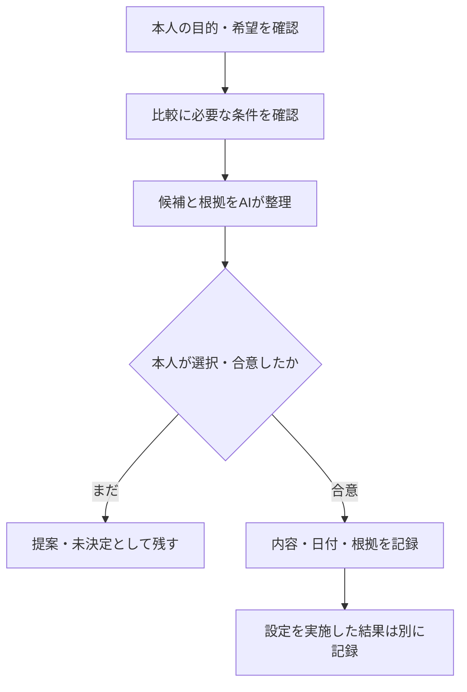

# プロジェクト設定

## 目次

- [最初に相談すること](#最初に相談すること)

- [目的と条件](#目的と条件)

- [言語とGit](#言語とgit)

- [決定の記録方法](#決定の記録方法)

## 最初に相談すること

まだ作品は選んでいない。初回は本人と次の3点を確認し、AIが回答を要約して下の表へ記録する。本人の知識確認や課題の回答とは区別する。

1. 何を作りたいか。

2. 誰の、どのような困りごとを助けたいか。

3. 最初に何ができたらうれしいか。

他の条件は候補比較に必要になった段階で確認してよい。全項目の一括回答を開始条件にしない。

## 目的と条件

| 項目 | 現在の内容 | 状態 |
|---|---|---|
| プロジェクト名 | 未設定 | 本人に確認 |
| 作りたいもの・理想 | 未設定 | 本人に確認 |
| 利用者と困りごと | 未設定 | 本人に確認 |
| 最初にできたらうれしいこと | 未設定 | 本人に確認 |
| 学びたいこと・経験の自己申告 | 未設定。知識の習得確認とは分ける | 本人に確認 |
| 使用する端末と配布方法 | 未設定 | 必要時に確認 |
| 予算・課金の可否 | 未設定。無料利用も未確認 | 必要時に確認 |
| 保存・共有・ログイン・外部サービスの条件 | 未設定 | 必要時に確認 |
| 使いたい、または避けたい技術 | 未設定 | 必要時に確認 |
| 開発環境の指定 | 未設定。既存環境があれば確認する | 必要時に確認 |
| 本番コードの配置先 | 未設定。出題時に新規パスを明記する | 技術選定後に確認 |

Next.js・TypeScript・Dockerなどの採用、サーバーやDBを使わないこと、端末内保存や静的公開は、このひな形では決定していない。候補の比較は[技術選定](technology.md)、MVPの範囲は[MVPの検討](mvp.md)へ記録する。

## 言語とGit

| 項目 | 現在の内容 | 状態 |
|---|---|---|
| 学習支援の言語 | 日本語 | 共通ルール |
| 画面・利用者向け文言の言語 | 未設定 | 本人に確認 |
| PR・コミットメッセージの言語 | 未設定 | Git利用時に確認 |
| コードコメントの言語 | 未設定。英語への統一を追加要求しない | 必要時に確認 |
| Git・PRを使うか | 未設定 | 本人に確認 |
| 新しいリポジトリのルート | 未設定。コピー先を確認する | Git設定時に確認 |
| リモートURL | 未設定 | Git設定時に確認 |
| 基準ブランチ | 未設定 | Git設定時に確認 |
| Gitを使わない場合の提出固定方法と移行条件 | 未設定 | その方式を選んだ場合に確認 |

## 決定の記録方法

更新時は「本人が決定」「AIの提案」「未決定」を区別し、確認日と会話・資料などの根拠を付ける。本人が選んだことと、設定が成功したことは別の事実として扱う。実施状況は[学習計画](plan.md)、実行結果は[検証記録](verification.md)へ記録する。
