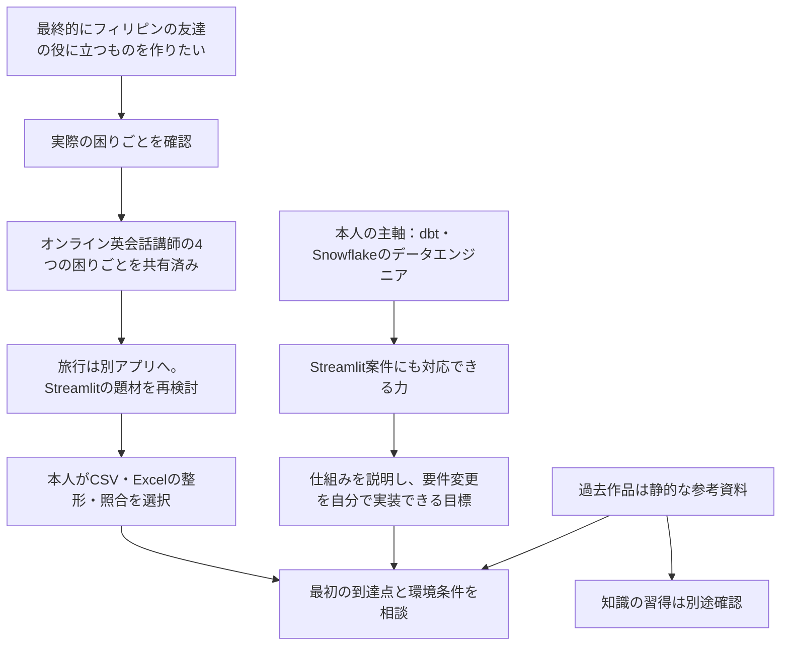
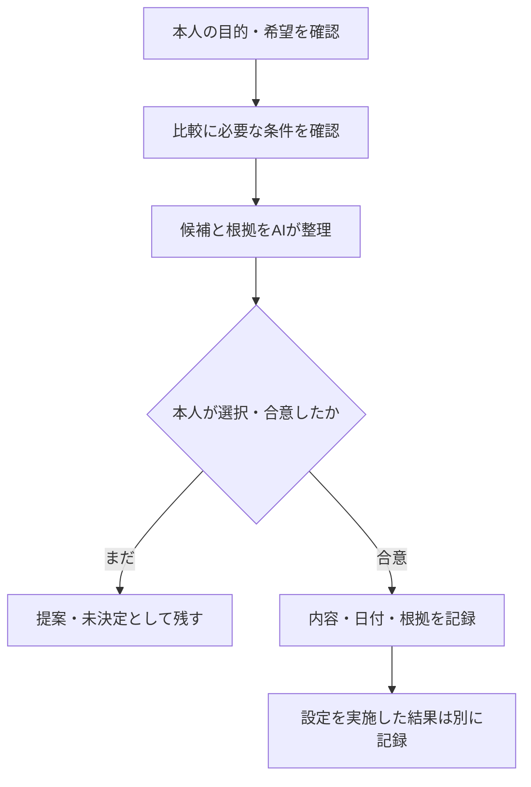

# プロジェクト設定

## 目次

- [最初に相談すること](#最初に相談すること)

- [目的と条件](#目的と条件)

- [言語とGit](#言語とgit)

- [決定の記録方法](#決定の記録方法)

## 最初に相談すること

2026-11-12の本人の回答から、Streamlitで実務的なアプリを自分で作れるようになることを目標として確認した。2026-11-13の追加説明で、将来の主軸はdbt・Snowflakeのデータエンジニアであり、Streamlitは提案しやすい案件へ対応するために学ぶ位置づけだと確認した。同日、最終的には毎日話すフィリピンの友達の役に立つものを作りたいと確認した。利用者の候補は友達。日本旅行プランは別のReactアプリで検討中のため、このStreamlitプロジェクトの対象から外す。最新情報の検索・比較に依存しない題材として、本人がCSV・Excelの整形・照合ツールを選択した。最初の到達点と環境条件は未合意。次の3点を引き続き相談し、AIが回答を要約して下の表へ記録する。本人の知識確認や課題の回答とは区別する。

1. 何を作りたいか。

2. 誰の、どのような困りごとを助けたいか。

3. 最初に何ができたらうれしいか。

他の条件は候補比較に必要になった段階で確認してよい。全項目の一括回答を開始条件にしない。

2026-11-13、本人からdbt・Snowflakeの目標を忘れずに扱うよう再確認があった。今後の題材選定では、友達への実用性、Streamlitの強み、dbt・Snowflakeのデータエンジニアとしての成長を一緒に評価する。今回の導入範囲・順序・環境・費用は別途確認し、本人の合意として先に確定しない。

## 目的と条件

| 項目 | 現在の内容 | 状態 |
|---|---|---|
| プロジェクト名 | 未設定 | 本人に確認 |
| 作りたいもの・理想 | CSV・Excelの整形・照合ツール。dbt・Snowflakeのデータエンジニアとしての成長とStreamlitの実務的な理解をつなげたい。最終的にフィリピンの友達の役に立つ目的は継続。日本旅行は別のReactアプリで検討 | 題材は本人が選択（2026-11-13、会話）。具体的な利用場面とMVPは未合意 |
| 利用者と困りごと | 毎日話すフィリピンの友達で、オンライン英会話の先生。ホームベースとオフィスベースの人がいる。給与計算、生徒対応による消耗、AIによる発言の誤帰属と警告、パスポート手続きが困りごと。詳細は下表。居住地・使用端末・希望言語は未確認 | 本人から聞いた具体例（2026-11-13、会話）。プラットフォームの仕様・規約や給与条件は未検証 |
| 最初にできたらうれしいこと | 選んだ題材の最初の到達点は未決定。AI案は、同じ種類の一覧を持つ2ファイルを整形して差分や不備を確認し、結果を出力できること | 題材選択とMVPの合意を区別。AI案は未合意（2026-11-13） |
| 学びたいこと・経験の自己申告 | データエンジニア数ヶ月（Python・SQL）、BIエンジニア2年、GASでSFDC代替アプリの開発経験あり。Streamlitの個人作品を複数作った経験があるが、AIに頼った部分があるため理解して作れるようになりたい。過去作品は下記を参照。各技術の理解度は未確認 | 本人の自己申告（2026-11-12、2026-11-13、会話）。作品内の技法を本人の習得済みとは扱わない |
| 使用する端末と配布方法 | 未設定 | 必要時に確認 |
| 予算・課金の可否 | 課金不可。Snowflakeアカウントは利用可能で、無料トライアルの残高と有効期限を本人が確認済み。有料化や有料API・有料公開基盤は使わない | 本人の回答（2026-11-13）。アカウントの状態は本人申告、AIは接続していない |
| 保存・共有・ログイン・外部サービスの条件 | 未設定 | 必要時に確認 |
| 使いたい、または避けたい技術 | Streamlitを使用したい。dbt・Snowflakeは将来の専門領域として希望。今回の学習での導入範囲・順序と、避けたい技術は未決定 | 本人の希望を確認（2026-11-12、2026-11-13、会話） |
| 開発環境の指定 | このMacのローカルで最初のCSVプレビューを準備。既存Python 3.12.0とuvを使い、検証は一時仮想環境で実施。課題用も独立した仮想環境にする | 前の提案と本人の回答に基づくAIの環境選定。詳細は技術選定を参照 |
| 本番コードの配置先 | 未設定。出題時に新規パスを明記する | 技術選定後に確認 |

Next.js・TypeScript・Dockerなどの採用、サーバーやDBを使わないこと、端末内保存や静的公開は、このひな形では決定していない。候補の比較は[技術選定](technology.md)、MVPの範囲は[MVPの検討](mvp.md)へ記録する。

実務学習の背景：勤務先はデータエンジニアリング・AI・分析支援を扱う会社で、Streamlit案件の要件も複雑そうだと本人は考えている（2026-11-13、本人の自己申告）。実案件の要件は未確認であり、友達向けの作品の必須要件にはしない。

2026-11-13の追加説明：皆プラットフォームの給与予測機能を使っていると本人から訂正された。給与システムのインタビュー負担も理由に給与案を除外し、一般的にフィリピンの人に役立つStreamlitの候補を検討する。その後、日本旅行への関心が示されたが、旅行プランは別のReactアプリで検討するため本プロジェクトの対象から外す。本人は、最新情報を常に必要としAI検索で代替しやすい案よりも、Streamlitの強みを生かす別の提案を希望している。

2026-11-13、本人から聞いた友達の困りごと。全てを今回の機能にすることには合意していない。

| 困りごと | 本人から聞いた内容 | 未確認の事項 |
|---|---|---|
| 給与の計算と入金までの見通し | 当初挙げられた困りごと。その後、既存の給与予測機能を使っていると本人から訂正 | 給与案は候補から除外。給与インタビューの負担も理由として本人が挙げた |
| 生徒対応による消耗 | 性的に不適切な言動をする生徒や、失礼な生徒への対応で気力を消耗する | 本人たちが望む支援、既存の通報・対応手順、アプリが助けられる範囲 |
| AIによる発言の誤帰属と警告 | 生徒が話したプライベートな内容を先生の発言としてAIが扱い、先生に警告が出る。繰り返すとアカウント停止になるという話 | 対象サービス、実際の事例、運営側の確認・異議申立て手順。判定や停止条件は公式には未確認 |
| パスポート手続きの負担 | 海外旅行をしたいが、パスポートのプロセスが面倒で手間がかかる | 具体的に迷う段階、申請条件、公式の最新手順。手続きそのものは今回未調査 |

過去作品：[logistics_simulator_snowflake](https://github.com/lovehakumai/logistics_simulator_snowflake)。2026-11-13、AIがコミット `244ffc05c828ef58849af761cd8d24c821647cfa` のREADMEと主要コードを一時フォルダで静的に参照した。Snowflake接続、複数画面、フォーム、Session State、物流費計算、クエリ履歴の可視化を含むことを確認した。作品は読み取り用に保持し、今回の本番コードや教材には転用しない。実行・正確性・費用・本人の理解度は未検証。

## 言語とGit

| 項目 | 現在の内容 | 状態 |
|---|---|---|
| 学習支援の言語 | 日本語 | 共通ルール |
| 画面・利用者向け文言の言語 | 未設定 | 本人に確認 |
| PR・コミットメッセージの言語 | 未設定 | Git利用時に確認 |
| コードコメントの言語 | 未設定。英語への統一を追加要求しない | 必要時に確認 |
| Git・PRを使うか | 共通文書はmainへ同期。課題ごとにtask/d_{NN}を作り、本人がPRを作成・マージする。AIは対象だけcommit・pushし、PRを作らない | 本人が課題別ブランチ・PR運用を選択（2026-11-13） |
| 新しいリポジトリのルート | `/Users/uramasaharu/Documents/develop/muscle_training_streamlit` | 本人指定の作業ルートでclone済み |
| リモートURL | `https://github.com/lovehakumai/muscle_training_streamlit.git`（origin） | 本人指定URLへ接続済み |
| 基準ブランチ | main。最初の課題ブランチはtask/d_01。同じ課題の知識確認から白紙・レビューまで同じブランチを使用 | 既存のmainと本人が選択した課題別PR運用（2026-11-13） |
| Gitを使わない場合の提出固定方法と移行条件 | 未設定 | その方式を選んだ場合に確認 |

## 決定の記録方法

更新時は「本人が決定」「AIの提案」「未決定」を区別し、確認日と会話・資料などの根拠を付ける。本人が選んだことと、設定が成功したことは別の事実として扱う。実施状況は[学習計画](plan.md)、実行結果は[検証記録](verification.md)へ記録する。
