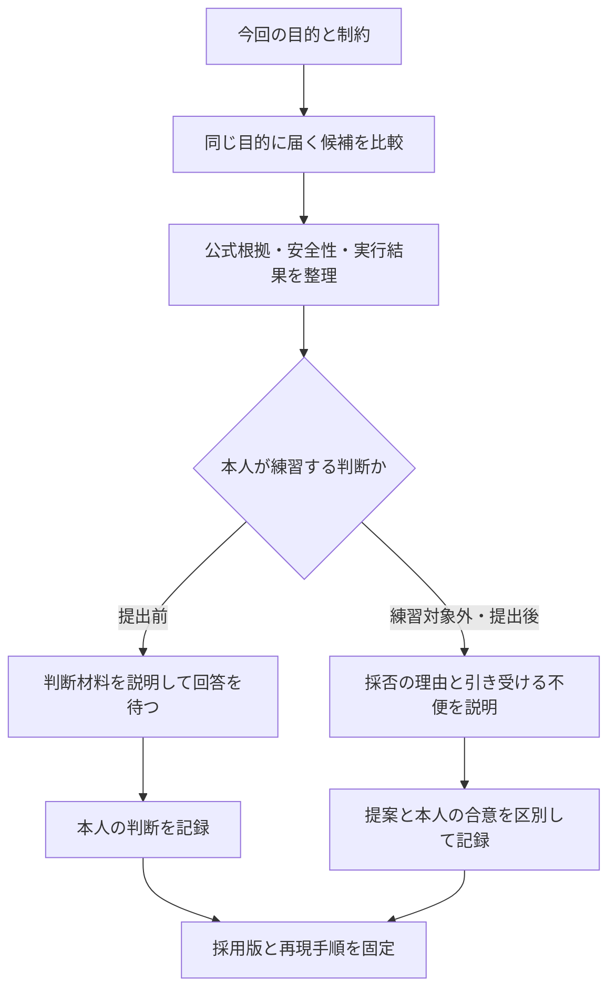

# 技術と実行環境の選定

## 目次

- [現在の状態](#現在の状態)

- [比較と決定](#比較と決定)

- [導入と環境の操作](#導入と環境の操作)

## 現在の状態

2026-11-12の会話で、本人がStreamlitを使うことを希望した。採用版・依存管理・保存方式・公開先・開発環境は未選定。インストール、版の固定、環境での実行も未実施。[プロジェクト設定](project.md)の条件を確認してから、必要な回に公式情報の確認と選定・検証を行う。

2026-11-13、本人がCSV・Excelの整形・照合ツールを題材として選択し、dbt・Snowflakeを主軸に学ぶ希望を再確認。役割のAI案は、Snowflakeが入力データと実行履歴を保持し、dbtが共通の変換・照合・品質検証を管理し、Streamlitがファイル入力・条件設定・結果調査・出力を提供する構成。具体的な取り込み方法、Excelの対応形式、任意の列への対応、dbtの実行方法、各技術の導入順序は未選定。Snowflakeの利用可能な環境と課金条件を本人に確認してから検証する。

## 比較と決定

| 確認すること | 残す内容 |
|---|---|
| 目的と制約 | 作る部品、学習対象、費用、端末、運用の条件 |
| 比較候補と比較軸 | 同じ目的に届く方法、必要知識、追加負担、保守、再現性 |
| 公式根拠 | 公式ページのURLと確認日、仕様、保守状況、アドバイザリ、ライセンス、必要な料金・規約 |
| 実行確認 | 指定環境、版、検証記録への参照、確認済みと未確認 |
| 採否と理由 | 本人の決定とAIの提案を区別した結論、引き受ける不便 |
| 依存の再現方法 | 採用版、固定方法、ロックファイルなど |

原資料や別プロジェクトの「確認済み」を流用しない。採用を決めたことと実際に動いたことは区別する。本人に求めた提出前の選択理由をAIが代筆しない。

## 導入と環境の操作

環境の手順は未作成。採用後に、AIが対象OS・実行場所・必要なツールと版・依存導入・起動・終了・生成物の場所・失敗時の確認方法を、1操作ずつ記録する。本人とAIの操作範囲を分ける。

環境の動作は[検証記録](verification.md)へ残す。ホストとコンテナなど、異なる環境での結果を混同しない。パッケージ管理や補助ツールは、それぞれの役割を説明してから導入する。

環境手順が長くなった場合に限り、別の環境ガイドへ分けてここからリンクする。未選定の段階で、特定技術用の設定ファイルや依存を追加しない。
