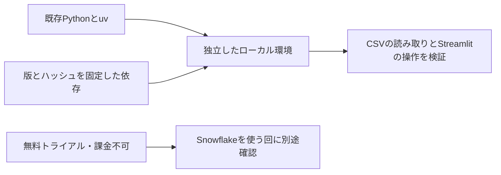
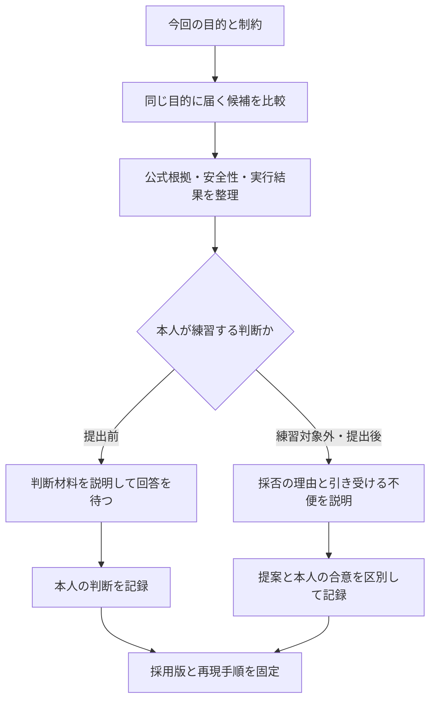

# 技術と実行環境の選定

## 目次

- [現在の状態](#現在の状態)

- [比較と決定](#比較と決定)

- [導入と環境の操作](#導入と環境の操作)

## 現在の状態

2026-11-12の会話で、本人がStreamlitを使うことを希望した。採用版・依存管理・保存方式・公開先・開発環境は未選定。インストール、版の固定、環境での実行も未実施。[プロジェクト設定](project.md)の条件を確認してから、必要な回に公式情報の確認と選定・検証を行う。

2026-11-13、本人がCSV・Excelの整形・照合ツールを題材として選択し、dbt・Snowflakeを主軸に学ぶ希望を再確認。役割のAI案は、Snowflakeが入力データと実行履歴を保持し、dbtが共通の変換・照合・品質検証を管理し、Streamlitがファイル入力・条件設定・結果調査・出力を提供する構成。具体的な取り込み方法、Excelの対応形式、任意の列への対応、dbtの実行方法、各技術の導入順序は未選定。Snowflakeの利用可能な環境と課金条件を本人に確認してから検証する。

## 比較と決定

2026-11-13の初回は、課金不可の条件でこのMacのローカルを選定した。Snowflakeは無料トライアルの残高・期限を本人確認済みだが、この回では接続しない。Pythonは既存の3.12.0を使い、既存のPython環境やdbtを変更しない。

2026-11-16、本人からPython 3.12.0のセキュリティへの懸念を受け、公式の修正版とローカルの導入状況を再確認した。その後、本人が3.13系の最新版を希望したため、現在はuv管理の3.13.18を使用し、許容範囲を `>=3.13.18,<3.14` とする。初回の3.12.0と途中の3.12.16の検証記録は過去の事実として保持する。候補比較・根拠・実測は[環境ガイド](environment.md)を参照。

| 用途 | 比較した方法 | 採否と理由・引き受ける不便 |
|---|---|---|
| 環境と依存の管理 | 既存uvによる独立環境と依存固定／標準venvとpip | AIは初回の環境に既存uv 0.13.7を選定。版とハッシュの固定ができるため。uvの操作が増えるので、環境操作は学習の採点対象にしない |
| CSVと表の実現性検証 | Python標準csvと表への変換／pandasの読み取り | 一時検証で両経路を比較した。学習では両者の入力と処理の役割を分けて説明する。本人の本番実装の方法を先に指定した決定ではない |
| 表示と操作 | Streamlit／PythonのCLIのみ | 表示と再実行の検証にはStreamlit、読み取りの比較にはCLIを使用。CLIでの成功を画面操作の成功には置き換えない |

初回の検証でStreamlit 1.67.0、pandas 3.1.1を実際に導入し、全33パッケージを固定した。2026-11-16、本人のuv管理・共有キャッシュ利用・ipykernel追加の希望に合わせ、`pyproject.toml` と `uv.lock` に移行した。既存33パッケージの版は維持し、ipykernel 7.4.0を開発用依存に追加した。環境は `uv sync --locked` で再現する。比較・公式根拠・操作・実測は[uvの環境ガイド](environment.md)に記録する。旧requirementsファイルはGit履歴に保持し、現在の管理元から外した。

導入したメタデータで、StreamlitはApache-2.0、pandasはBSD-3-Clause、いずれもPython要件は3.11以上と確認した。両プロジェクトの公式アドバイザリを閲覧し、固定した33パッケージの名前・版をOSVへ照会した結果、該当する公開情報の返却は0件だった。これは今回の照会範囲の結果であり、依存の安全性全体や将来の状態を検証したものではない。

公式根拠（2026-11-13参照）：[Streamlitのローカル導入](https://docs.streamlit.io/get-started/installation/command-line)、[uvの依存固定](https://docs.astral.sh/uv/pip/compile/)、[Pythonのcsv](https://docs.python.org/3.12/library/csv.html)、[pandasのread_csv](https://pandas.pydata.org/docs/reference/api/pandas.read_csv.html)、[Streamlitのアドバイザリ](https://github.com/streamlit/streamlit/security/advisories)、[pandasのアドバイザリ](https://github.com/pandas-dev/pandas/security/advisories)、[OSVの照会API](https://google.github.io/osv.dev/post-v1-querybatch/)。

| 確認すること | 残す内容 |
|---|---|
| 目的と制約 | 作る部品、学習対象、費用、端末、運用の条件 |
| 比較候補と比較軸 | 同じ目的に届く方法、必要知識、追加負担、保守、再現性 |
| 公式根拠 | 公式ページのURLと確認日、仕様、保守状況、アドバイザリ、ライセンス、必要な料金・規約 |
| 実行確認 | 指定環境、版、検証記録への参照、確認済みと未確認 |
| 採否と理由 | 本人の決定とAIの提案を区別した結論、引き受ける不便 |
| 依存の再現方法 | 採用版、固定方法、ロックファイルなど |

原資料や別プロジェクトの「確認済み」を流用しない。採用を決めたことと実際に動いたことは区別する。本人に求めた提出前の選択理由をAIが代筆しない。

## 導入と環境の操作

初回のローカル環境の手順は、課題ブランチのREADMEとguide/handson.mdに作成済み。2026-11-16には教材の起動・操作・終了と記録先を確認した。他の環境や技術は採用後に、AIが対象OS・実行場所・必要なツールと版・依存導入・起動・終了・生成物の場所・失敗時の確認方法を、1操作ずつ記録する。本人とAIの操作範囲を分ける。

環境の動作は[検証記録](verification.md)へ残す。ホストとコンテナなど、異なる環境での結果を混同しない。パッケージ管理や補助ツールは、それぞれの役割を説明してから導入する。

環境手順が長くなった場合に限り、別の環境ガイドへ分けてここからリンクする。未選定の段階で、特定技術用の設定ファイルや依存を追加しない。

課題ブランチでは、ルートで `uv sync --locked` を実行して `.venv` と固定依存を用意する。操作は[uvの環境ガイド](environment.md)と課題のREADMEに置く。仮想環境・キャッシュ・秘密情報はGitに含めない。知識確認の回答時点では依存の導入やサーバーの起動を本人に要求しない。Snowflakeへの接続・dbtの導入は初回のローカル環境手順に含めない。
