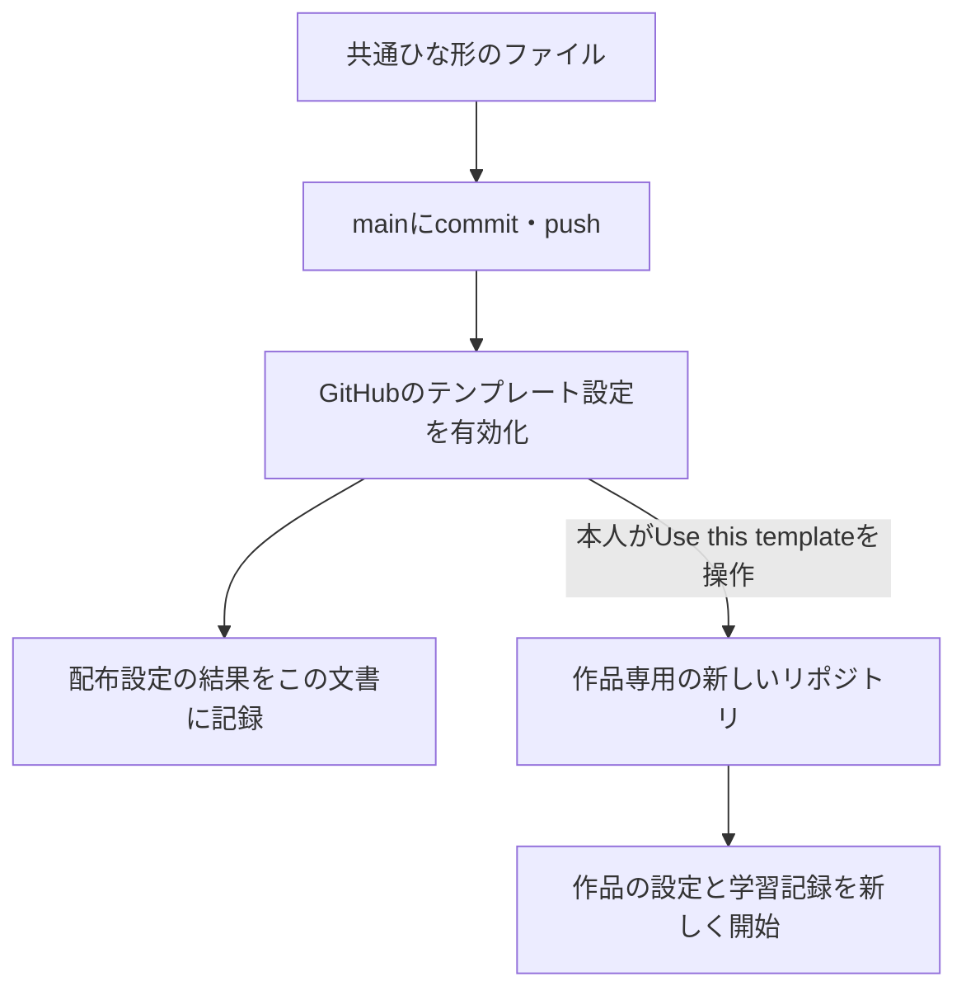

# ひな形の配布設定記録

## 目次

- [対象と作品用設定との区別](#対象と作品用設定との区別)

- [実施結果](#実施結果)

- [実行環境と確認](#実行環境と確認)

- [確かめていないこと](#確かめていないこと)

- [用語](#用語)

## 対象と作品用設定との区別

本人が指定した [lovehakumai/muscle_training_template](https://github.com/lovehakumai/muscle_training_template) に、AIが共通の学習用ひな形を登録した記録です。確認日は2026-11-12（日本時間）です。

たとえば、このひな形から読書記録アプリを作る場合、その作品の接続先・技術・学習実績は新しく設定します。この記録の保存先や確認結果を作品用の [プロジェクト設定](project.md)・[学習計画](plan.md)・[検証記録](verification.md)へ転記しません。

## 実施結果

| 項目 | 確認した事実 |
|---|---|
| 作業ルート | `/Users/uramasaharu/Documents/develop/muscle_training_base`。作業前はGitリポジトリではなかった |
| 保存先の指定 | 本人が会話で `https://github.com/lovehakumai/muscle_training_template.git` を指定 |
| 接続 | `origin` に指定URLを設定。初回登録前の `git ls-remote` は成功し、参照の出力は空だった |
| 基準ブランチ | AIが初回登録に `main` を使用。push後にGitHubの既定ブランチも `main` と確認 |
| 初回commit | `e9a55d36a0a3c7ef08d18c32858529f6af77686d`。ひな形12ファイルを対象に保存 |
| 初回push | `git push -u origin main` が成功。GitHub側の `refs/heads/main` が初回commitと一致 |
| テンプレート設定 | `gh repo edit lovehakumai/muscle_training_template --template` を実行後、APIで `is_template: true` を確認 |
| 公開範囲 | API確認時点で `private` |
| レビュー合格 | 学習課題は未出題。課題レビューは未実施 |
| PR・マージ | 今回は初回登録。PR作成・マージは未実施 |

commitメッセージはAIが日本語で作成しました。本人の英語力や、新しい作品で使う言語の決定には算入しません。

## 実行環境と確認

実施者はAIです。macOS 26.6.2（25G83）、Git 2.50.1（Apple Git-155）、GitHub CLI 2.100.0を使用しました。上記の作業ルートで、初回登録の対象12ファイルを入力として確認しました。

| コマンド・操作 | 出力・確認範囲 |
|---|---|
| `git init -b main` | 作業ルート内に独立したリポジトリを作成 |
| `git remote -v` | fetch・pushとも本人指定のURL |
| Markdownのローカル参照とMermaid図を検査 | 初回commit前の12文書で、参照切れ・図の欠落なし |
| `git diff --cached --check` | 初回commit前の対象で終了コード0、指摘なし |
| `git ls-remote --symref origin HEAD refs/heads/main` | `HEAD` は `refs/heads/main`。初回push後のハッシュは初回commitと一致 |
| `gh api repos/lovehakumai/muscle_training_template` | 設定後に `default_branch: main`、`is_template: true`、`visibility: private` を確認 |

標準のGitHub CLI認証でのAPI確認は404でした。Gitのpushで使用できた既存認証を、その実行中だけAPIにも使用して設定と確認を完了しました。認証情報の表示・ファイル保存・恒久的な認証設定の変更は行っていません。

テンプレート設定の公式根拠は [GitHubのテンプレートリポジトリ作成手順](https://docs.github.com/en/repositories/creating-and-managing-repositories/creating-a-template-repository) と [GitHub CLIのrepo edit](https://cli.github.com/manual/gh_repo_edit) です。2026-11-12に確認しました。

## 確かめていないこと

| 対象 | 確認する時期 | 実施者と操作 |
|---|---|---|
| テンプレートからの作品専用リポジトリの生成 | 作りたいものが決まったとき | 本人がGitHubの `Use this template` から新しいリポジトリを作る |
| 新しい作品の教材・本番の動作 | 作品と環境を選定した後 | AIが作品用の設定に従い、課題ごとに実行検証する |

## 用語

| 用語 | 平易な説明 |
|---|---|
| 配布設定 | 共通ひな形をGitHubから使い始められるようにする設定 |
| 参照 | Gitがブランチ名などとcommitを対応付ける情報 |
| ハッシュ | commitを識別する文字列 |
| API | コマンドなどからサービスの情報を取得・変更する窓口 |
