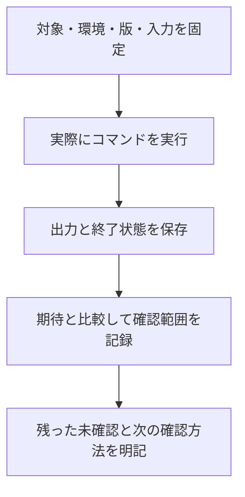

# 実行検証の記録

## 目次

- [現在の状態](#現在の状態)

- [実行時に残すこと](#実行時に残すこと)

- [確かめていないこと](#確かめていないこと)

## 現在の状態

2026-11-13、最初のCSVプレビューの実現性をAIがローカルの一時領域で検証した。本番アプリはまだ作成していない。2026-11-16に別題材のハンズオン教材も作成し、別途13項目と起動・停止を検証した。Snowflake・dbtの接続や実行は行っていない。下表は初回の一時検証の結果。

| 項目 | 実際の確認 |
|---|---|
| 環境 | macOS 26.6.2、Python 3.12.0、Streamlit 1.67.0、pandas 3.1.1、uv 0.13.7 |
| 実行場所 | `/private/tmp/muscle-csv-verify` の独立仮想環境。既存のPython環境とは分離 |
| 入力と実施者 | AIが作った架空のCSVと一時検証アプリ。本人の操作結果ではない |
| 実行 | `STREAMLIT_BROWSER_GATHER_USAGE_STATS=false /private/tmp/muscle-csv-verify/.venv/bin/python /private/tmp/muscle-csv-verify/verify_probe.py` |
| 結果 | 正常・境界・失敗時・再実行の19項目がPASS |
| サーバー | 一時アプリを127.0.0.1:18543で起動。`/_stcore/health` はHTTP 200、本文 `ok`。検証後に終了を確認 |
| 補足 | 診断用の別のカウンター画面も初期表示と2回の操作をAppTestで検証。問題文には解答を掲載しない |
| 未確認 | 人が実ブラウザで操作した結果、Excel、Snowflake、dbt、本番コードの動作 |

詳細は[task/d_01の検証記録](https://github.com/lovehakumai/muscle_training_streamlit/blob/task/d_01/tasks/d_01/verification.md)に保存する。一時実装は本番や教材の解答として配布しない。

2026-11-16のハンズオンはPython 3.12.0・pandas 3.1.1・Streamlit 1.67.0で検証。プロジェクトのルートから、一時領域の検証コードを `.venv/bin/python /private/tmp/d01-handson-20261116/verify.py` で実行し、終了コード0、13項目全てPASSを確認した。指定された教材の変更も一時コピーで検証し、本人の観察や回答のファイルは作っていない。教材のlocalhost起動は127.0.0.1:18501でHTTP 200・本文ok、終了も確認した。

[ハンズオンの実測記録](https://github.com/lovehakumai/muscle_training_streamlit/blob/task/d_01/tasks/d_01/handson-verification.json)は課題ブランチに保存する。AIの実測と、これから本人が行うブラウザ操作・記述・本番実装の結果を区別する。

2026-11-16、uvの共有キャッシュを使って依存管理を移行した。`uv sync --locked --no-python-downloads` と `uv pip check --python .venv/bin/python` は終了コード0。既存33パッケージの版と本人の編集中ファイルのハッシュが一致した。ipykernel 7.4.0で一時カーネルを起動し、プロジェクトのPython・主要依存・計算結果42・正常終了を確認した。環境・入力・コマンド・出力・未確認の詳細は[環境ガイド](environment.md)へ記録する。

同日、Pythonを3.12.16へ更新した。`uv run --locked python --version` は `Python 3.12.16`、依存の整合性確認は成功。59パッケージの版と本人の編集中コードを保持した。元の教材を一時コピーで13項目検証し、ipykernelの起動・実行・終了も確認した。[環境ガイドの更新記録](environment.md#pythonのセキュリティ更新)に、初回と更新後を区別して残す。

同日、本人の3.13系最新版の指定に合わせて3.13.18へ更新した。`uv run --locked python --version` は `Python 3.13.18`。依存59パッケージの版と本人の編集を保持し、元の教材13項目とipykernelの起動・計算・終了を確認した。[3.13系への移行記録](environment.md#python-313系への移行)を参照。

## 実行時に残すこと

| 項目 | 記録する内容 |
|---|---|
| 対象と実施者 | 教材か本番か、対象部品、AIか本人か |
| 日付と版 | 実施日、OS、実行環境、ランタイム、主要依存の版 |
| 実行場所と入力 | 作業ディレクトリ、実際の入力、事前の状態 |
| コマンド | 実際に実行したコマンドと必要な条件 |
| 出力と判定 | 返った値・終了状態、期待との比較。本人の観察とは分ける |
| 確認範囲 | 正常、必要な境界、失敗時、未確認の範囲 |

教材の指定操作だけでなく、別入力でも確認する。複数の実装を許す課題では2通りで期待を確認する。本番は本番のコードを動かして既存部品との接続まで確認し、教材の成功で代替しない。

実行できない場合は机上の照合と明記する。日付・版・入力・出力を推測で埋めない。各課題固有の記録は、出題時に課題内の `verification.md` へ作り、この文書からリンクする。

## 確かめていないこと

| 対象 | 確認する時期 | 実施者と操作 |
|---|---|---|
| 開発環境での再現 | 環境候補の選定時 | AIが合意した環境で最小の起動・終了を実行する。画面操作が必要なら本人へ手順を伝える |
| 教材と本番要件の実現性 | 各課題の技術検証段階 | AIが正常・必要な境界・失敗時の入力を実行する |
| 本人の提出コードの動作と接続 | 当該段階の提出レビュー時 | AIが公開済み基準の範囲で本番コードを実行する |

作品と環境が決まった後、各行の対象と操作を具体化する。課題を止める未確認があれば、解消するまで実行課題を確定しない。
