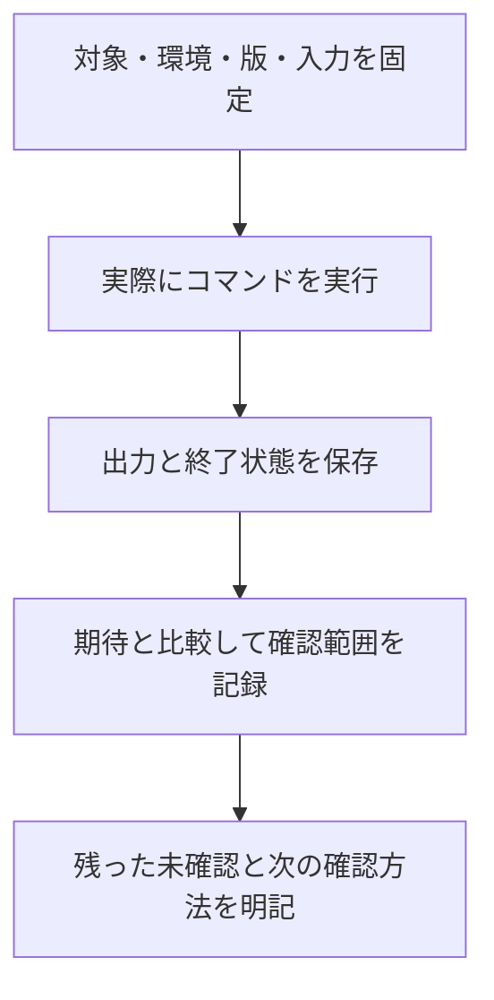

# 実行検証の記録

## 目次

- [現在の状態](#現在の状態)

- [実行時に残すこと](#実行時に残すこと)

- [確かめていないこと](#確かめていないこと)

## 現在の状態

新しい作品・教材・開発環境の実行検証は未実施。この文書は記録の方法を示すもので、検証結果ではない。ひな形の文書チェックと、新しい作品の動作検証は区別する。

## 実行時に残すこと

| 項目 | 記録する内容 |
|---|---|
| 対象と実施者 | 教材か本番か、対象部品、AIか本人か |
| 日付と版 | 実施日、OS、実行環境、ランタイム、主要依存の版 |
| 実行場所と入力 | 作業ディレクトリ、実際の入力、事前の状態 |
| コマンド | 実際に実行したコマンドと必要な条件 |
| 出力と判定 | 返った値・終了状態、期待との比較。本人の観察とは分ける |
| 確認範囲 | 正常、必要な境界、失敗時、未確認の範囲 |

教材の指定操作だけでなく、別入力でも確認する。複数の実装を許す課題では2通りで期待を確認する。本番は本番のコードを動かして既存部品との接続まで確認し、教材の成功で代替しない。

実行できない場合は机上の照合と明記する。日付・版・入力・出力を推測で埋めない。各課題固有の記録は、出題時に課題内の `verification.md` へ作り、この文書からリンクする。

## 確かめていないこと

| 対象 | 確認する時期 | 実施者と操作 |
|---|---|---|
| 開発環境での再現 | 環境候補の選定時 | AIが合意した環境で最小の起動・終了を実行する。画面操作が必要なら本人へ手順を伝える |
| 教材と本番要件の実現性 | 各課題の技術検証段階 | AIが正常・必要な境界・失敗時の入力を実行する |
| 本人の提出コードの動作と接続 | 当該段階の提出レビュー時 | AIが公開済み基準の範囲で本番コードを実行する |

作品と環境が決まった後、各行の対象と操作を具体化する。課題を止める未確認があれば、解消するまで実行課題を確定しない。
