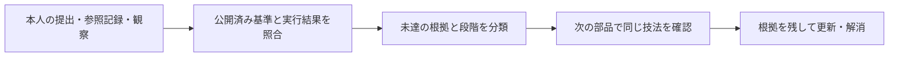

# 学習履歴と弱点

## 目次

- [未学習](#未学習)

- [繰り返す弱点](#繰り返す弱点)

- [解消したもの](#解消したもの)

- [記録の方法](#記録の方法)

## 未学習

提出レビュー未実施。記録なし。初学者として説明することと、提出で未学習を確認したことは区別する。知識確認で判明した要学習は各課題の `knowledge.md` に記録する。

## 繰り返す弱点

記録なし。同種の再生・誤りが3タスク以上にまたがった場合に、根拠付きで追加する。

## 解消したもの

記録なし。対象の弱点について2回連続で成功した場合に移し、元の履歴も保持する。

## 記録の方法

| 分類 | 確認する根拠 | 次の扱い |
|---|---|---|
| 未学習 | 今回初めて扱う機能の仕組みを知らなかった | 同じ技法を次の部品でも使い、難度を上げない |
| 再生 | 既習だが、今回の操作・説明・白紙実装を組み立てられなかった | どの段階で未達だったか明記する |
| 誤り | 書けたが、公開済みの要件・境界・欠けた値などを外した | 入力と結果を根拠に再確認する |

更新時は課題ID・段階・基準ID・本人の記録への参照・検証結果・分類・次回の扱いを残す。別プロジェクトの記録は参照元付きの確認材料として扱い、この作品で確認した実績にしない。中止した課題や方針変更を弱点の根拠にしない。

未学習が3つ以上たまったら新しい部品へ進まず復習する。学習後の説明・小問・実装で確認し、読んだことだけで解消しない。
