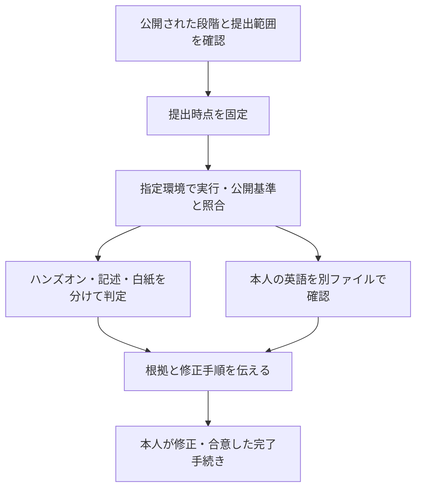

# 学習成果のレビュー

## 目次

- [提出段階を確認する](#提出段階を確認する)

- [実行して判定する](#実行して判定する)

- [フィードバックを残す](#フィードバックを残す)

- [学習履歴と完了手続き](#学習履歴と完了手続き)

## 提出段階を確認する

[現在地](../../docs/plan.md)、[共通ルール](../../AGENTS.md)、[プロジェクト設定](../../docs/project.md)、対象課題のREADME・knowledge・ガイド・公開済みの採点表、本人の提出物・notes・PR本文、過去レビューを読む。原資料が別にある場合は、現行ルールと区別する。

未公開・中止・保管した課題は採点しない。準備段階で採点表が未公開なら、採点せず現在の段階を伝える。空の採点表を合格0/0として完了扱いにしない。白紙課題が未出題ならその状態を記録し、不合格や完了にしない。

本人と提出範囲を確認し、提出時点を固定する。Git運用では対象パスのコミットを記録する。未コミットの提出は共通ルールに沿って対象だけをcommit・pushする。設定が未完了ならpush済みとしない。Gitを使わない場合は合意した保存方法を使う。本人のコードと回答は変更しない。

## 実行して判定する

| 対象 | 確認する根拠 | 記録先 |
|---|---|---|
| ハンズオン結果 | 本人の入力・操作・変更前後・出力。本人の観察とAIの再実行を区別する | 技術レビューのハンズオン区分 |
| 記述回答 | 求めた数と形式、ガイドの材料、本人が観察した事実との整合 | 技術レビューの記述区分 |
| 本番の白紙実装 | 公開したC行、本番コードの実行、既存部品との接続、参照記録 | 技術レビューの白紙区分 |
| 英語 | 本人のPRタイトル・本文・コミット・識別子・英語コメント・英語画面文言 | `english.md` |

段階ごとに公開したやること表と採点表を1対1で照合し、IDごとに合否と根拠を記録する。段階別の合格数を示し、未出題・未提出は合計に混ぜない。公開表にない品質基準を追加せず、許される本人のAssumptionsを尊重する。

指定環境で本人の提出を実際に動かし、日付・版・実行場所・入力・コマンド・出力を残す。教材だけの成功を本番や理解の成功にしない。本番は既存部品との接続まで、公開済み基準の範囲で確認する。

実行できなければ冒頭に机上の照合であると書き、未検証範囲・確認する時期・実施者・操作を残す。机上の予測を実測にしない。教材や環境の不具合、未習の技法を要求した出題側の問題は本人の減点と分ける。本人が変更した教材を上書きせず、不具合修正は本人の変更を保持する方法で行う。

参照したことだけで不合格にしない。完成コードを参照した記録がある場合は動作の合否と自力で組み立てられるかの未確認を分ける。参照履歴や本人の回答を推測で補わない。ガイドにない知識や英語の巧拙を技術の合否へ混ぜない。

## フィードバックを残す

`tasks/d_{NN}/review_{NN}/README.md` に、提出時点・環境・段階別合否表・実測した長所・前回からの改善・直す点・検証記録・未確認を残す。初回に架空の改善を作らない。未達は全て表へ残し、今回優先する修正は1〜2点に絞る。

修正は、次の部品への影響・公開仕様の違反・今後の重要性の順で選ぶ。場所と行・入力と実測値・なぜ困るか・1手順1動作の直し方・再確認方法を伝える。解答コードや本人の記述の書き直しは渡さない。

技術レビューには入力・処理・結果や問題箇所を説明するMermaid図を入れる。技術選定を扱う場合は、目的・制約・候補・根拠・採否・引き受ける不便を図と表で追えるようにし、本人の判断とAIの提案を区別する。

英語は毎回同じレビュー内の `english.md` へ分ける。原文の意味と読み手への伝わり方を区別し、綴り・文法は「原文 → 修正」の形式で記録する。確認の流れや意味の伝わり方をMermaid図で示す。本人の英語だけを対象とし、AI作成文やコメントの英語統一を本人の評価に加えない。

PR未作成なら取得できた対象だけを確認し、PRは未確認とする。英語表現がない対象は対象なしと記録する。独立した読み手による確認は、実際にその体制を利用でき、委任が許可されている場合だけ行い、未実施を実施済みにしない。

## 学習履歴と完了手続き

[弱点記録](../../docs/weaknesses.md)へ、課題ID・段階・基準ID・本人の記録への参照・検証結果・分類・次回の扱いを記録する。初学者という理由だけで弱点を埋めない。

| 分類 | 根拠 | 次の扱い |
|---|---|---|
| 未学習 | 初見で仕組みを知らなかった | 次の部品も同じ技法を使い、難度を上げない |
| 再生 | 既習だが求められた操作・説明・白紙実装を組み立てられなかった | どの段階の根拠か明記する |
| 誤り | 書けたが公開済み要件や境界を外した | 入力と結果を記録して確認する |

同種の再生・誤りが3タスク以上なら繰り返す弱点に追加し、2回連続成功で解消欄へ移す。履歴は残す。未学習が3つ以上なら新しい部品へ進まず復習する。学習後は説明・小問・実装の根拠でknowledgeの状態を更新し、本人の回答は作らない。

ハンズオンだけのレビュー依頼には、その段階だけを返す。本番の白紙実装は未完了として残す。全段階の提出と必要な修正後に、プロジェクト設定に沿って完了手続きを案内する。

Git・PR運用では対象パスだけをcommit・pushし、本人の本文を使う具体的なPR作成コマンドを渡す。AIはPRを作成・マージしない。レビュー合格とマージ済みを区別し、本人のマージを確認してから次課題へ進む。

最後に計画の現在地を更新する。会話では「合格数・実測した長所・前回からの改善・優先して直す点」の順に伝え、本人の修正や提出を待つ。
