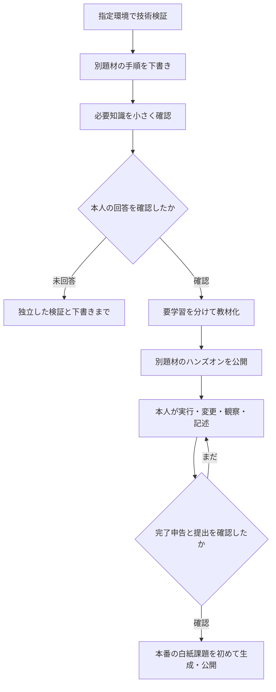

# 学習課題の作成

## 目次

- [開始前に読むもの](#開始前に読むもの)

- [MVPから今回の部品を選ぶ](#mvpから今回の部品を選ぶ)

- [検証と知識確認](#検証と知識確認)

- [別題材の教材とハンズオン](#別題材の教材とハンズオン)

- [完了後の白紙課題](#完了後の白紙課題)

- [採点基準と引き渡し](#採点基準と引き渡し)

## 開始前に読むもの

[現在地](../../docs/plan.md)、[共通ルール](../../AGENTS.md)、[プロジェクト設定](../../docs/project.md)、[設計](../../docs/design.md)、[弱点記録](../../docs/weaknesses.md)、存在する直前のレビューを読む。MVP選定時には[MVPの検討](../../docs/mvp.md)、依存や環境を導入する回には[技術選定](../../docs/technology.md)を読む。

作業ルート・未コミット差分・運用設定を確認する。ひな形が親リポジトリ内にあるだけの場合は独立した課題を開始しない。Git・PR運用では前課題が未マージなら次課題を出さない。ハンズオンから白紙への移行は同一課題・同一ブランチで扱う。

既存課題がある場合は、現在の段階・公開済み課題表・採点表を確認する。本人の回答・学習用コード・観察記録は変更しない。方針変更による再出題は本人の明示的な依頼に基づき、旧資料と履歴を保持し、新旧の採点基準を混ぜない。

## MVPから今回の部品を選ぶ

作品やMVPが未決定なら、まず目的と制約を本人と確認する。理想を学習分野に分解し、再利用の広さ・小さく動かせるか・本人の費用条件・追加負担を軸に候補を比較する。AIが最小限の実行検証をし、本人と到達点を確認する。

目的・制約・候補・比較軸・公式根拠・検証結果・採否の理由・引き受ける不便を図と表に残す。本人の練習対象の判断については、比較材料までにとどめ、本人の選択理由を先に書かない。

合意したMVPを部品ごとに分け、今回は1分野・1到達点を詳しく扱う。後の回の番号と分割は提案にとどめ、全課題や完成コードを先に作らない。

## 検証と知識確認



1. AIが、教材と本番要件の実現性を指定環境で確認する。正常・必要な境界・失敗時を動かし、日付・版・環境・入力・コマンド・出力・未確認を課題内の `verification.md` に記録する。

2. AIが、本番と異なる用途・データの手順を下書きし、必要知識を細かく列挙する。本番要件を試すAIの実装は一時領域へ隔離し、教材や本番の解答として公開しない。

3. AIが、少数ずつ短い説明・別題材の出力予想・小さな操作で知識を確認する。自己申告だけを習得の根拠にせず、課題の答えや本人に求める設計判断を診断で聞かない。

4. AIが、本人の回答を根拠に `knowledge.md` へ「ID・知識項目・必要な手順・確認済み／要学習／未確認・根拠・参照文書」を記録する。知識確認は採点しない。未回答や資料を読んだだけの項目を確認済みにしない。

回答待ちの作業は、理解度に依存しない検証と手順の下書きまで。未確認の知識を前提に進む必要があれば、範囲を本人と確認する。作業を止める未確認は出題前に解消する。

## 別題材の教材とハンズオン

以下は出題時に作る配置の説明。ひな形の段階で課題・提出物・本番コードを作らない。

```text
tasks/d_{NN}/
  README.md          今回の段階、やること表、担当、入力、提出方法
  constraints.yml    ハンズオン・記述の採点表。本人は開かない
  knowledge.md       必要知識と本人の回答を根拠にした状態
  verification.md    AIの技術検証と未確認
  guide/
    README.md        読む順序
    handson.md       読む・実行・変更・観察・記述の手順
    01-theme.md      要学習を分けた学習文書
  handson/           本番とは別題材の教材コード
  submit/            本人が回答とnotes.mdを書く場所
  review_{NN}/       提出後の技術レビューとenglish.md
```

README冒頭に「やること」表を置く。実行・観察をS行、記述をW行とし、完了後に別基準の白紙段階があることを予告する。AIと本人の担当をファイル名で示す。ハンズオンと白紙のやること表は合計6行以下、仕様は各段階3条以下、本人が変更・実装するコードは150行以内を分割の目安にする。環境設定を本人の学習量に数えない。

要学習は1文書1テーマに分ける。冒頭の要点・縦の目次・具体例・実測結果・説明・別題材の練習問題・未確認・末尾の用語表を用意する。図は本文の流れや関係を説明するものにする。記述回答や観察の結論は書かない。

ハンズオンの各ステップに、読む章への直接リンク・実行操作・見る対象・記述問題への対応を示す。本人が判断する結論や観察結果は埋めない。練習問題は課題表に載せた場合だけ採点する。

本番と違う用途・データ・画面を使い、名前の置換だけで本番が完成する教材は作り直す。データを扱う回は1件の単位・ID・由来と型・空や欠けた値・0件と境界・順序・再実行・語の定義を必要な範囲で表にする。本番全体の完成設計を先に提示しない。

記述問題は1問1判断、小問は3つまでとし、参照する章・節と回答の数・形式を指定する。比較の材料はガイドに置くが、そのまま写せる回答文を用意しない。本人が実際に変更・観察した事実を理由と結び付けられる問題にする。

教材の指定操作に加え、別入力でも確認する。複数実装を許す場合は2通りで期待を確認する。依存を追加する回は共通ルールに沿って公式根拠と版・ロックを確認する。AI作成のコードには担当範囲を明記し、本人が変更を始めたファイルを上書きしない。

## 完了後の白紙課題

本人のハンズオン完了申告と操作結果・記述の提出を確認してから、同じ課題の `practice/README.md` と `practice/constraints.yml` を初めて作る。ファイルがあるだけでは完了としない。この確認で模範回答や本番の解答を渡さない。

白紙READMEには対象部品・やること表・仕様・入力・参照できる資料・担当境界・本番で本人が新規作成するパス・提出方法・Mermaid図を置く。採点IDはC行とし、S・W行と重複させず、元の表を変更しない。

学んだ技法だけで本番MVPの部品を実装できる範囲にする。AIは練習対象外の環境と表示部品だけ用意でき、本人の関数・型・処理の雛形やTODO入りの骨格を作らない。本番の接続も学習対象なら本人が実装する。既存の本人のコードを削除して白紙へ戻さない。

参照可は公式資料と学習文書の説明、参照不可はハンズオンの完成コードと過去の同課題の解答と明記する。全資料を閉じた暗記は求めない。出題後から提出までは解答・追加ヒント・本人の判断や観察の代筆をしない。

## 採点基準と引き渡し

採点表のIDと当該段階のやること表のIDを1対1にする。採点用YAMLはAI担当と先頭に明記し、本人は開かない。各行には公開基準と、その根拠の節・入力・確認操作・許される結果を記録する。critical指定は課題文で明示的に重要としたものだけにする。隠れた条件を作らない。

未確認は「何を・いつ・誰が・どう動かすか」を明記する。検証できなかった範囲や教材側の不具合を本人の減点にしない。

設定済みのGit・PR運用では対象パスだけをcommit・pushし、本人の本文ファイルを使う具体的なPR作成コマンドを渡す。本文の回答は代筆しない。節目だけWhy / Alternative / Verifiedを求め、通常はWhat / Assumptionsでよい。言語はプロジェクト設定に従う。

最後に現在地を更新し、今回の段階・読む入口・到達点・提出物・未確認を短く伝える。本人の回答や提出を待ち、このスキルで採点はしない。
