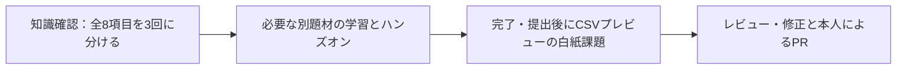
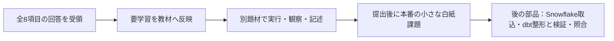
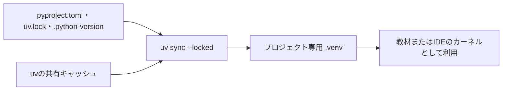

# d_01：単一CSVの読み込みとプレビュー

課題全体の到達点は、CSVを1つ読み込み、先頭のゼロや空欄を意図せず変えずに表で確認でき、画面操作時の再実行を説明できることです。

現在はハンズオンと記述の段階です。K01〜K08の回答は全て受領しました。追加の知識確認はなく、これまでの回答の書き直しも不要です。次は[ハンズオンの手順](guide/handson.md)を開き、下表の3つを順に進めます。

| やることID | 今やること | 提出するもの |
|---|---|---|
| S01 | 観測CSVのCLI教材を実行し、2つの値を変更して読み取りを観察 | 指定変更、変更前後の出力、本人の操作・観察記録 |
| S02 | メモファイルと状態の画面を操作し、初期値も変更して観察 | 指定変更、本人の操作・観察記録 |
| W01 | 実測と処理のつながりを3つの観点で説明 | 本人が書くsubmit/answers.md |

対象・操作・入力・提出方法の詳細は[ハンズオン](guide/handson.md)に固定しています。教材はAIが用意し、本人が変更・実行・観察・記述します。本番の白紙仕様は、ハンズオンの完了申告と提出を確認した後に公開します。

## 目次

- [全体の流れと知識確認の範囲](#全体の流れと知識確認の範囲)

- [今回の到達点と位置づけ](#今回の到達点と位置づけ)

- [回答のしかた](#回答のしかた)

- [K01](#k01)

- [K02](#k02)

- [K03](#k03)

- [担当と次の段階](#担当と次の段階)

- [環境の準備について](#環境の準備について)

- [Gitの進め方](#gitの進め方)

- [用語](#用語)

## 全体の流れと知識確認の範囲

課題01は、知識確認・別題材の練習・本番の小さな実装・レビューを同じブランチで進めます。知識確認は、必要な説明と練習を調整するために行い、全8項目を受領しました。全問正解を次へ進む条件にはせず、分からない項目は教材で学びます。

| 段階 | 本人が行うこと | 現在の状態 |
|---|---|---|
| 知識確認 | 下記の8項目について短い予想・説明で回答する | K01〜K08を受領済み。追加の知識確認はない |
| 別題材のハンズオン・記述 | 教材を実行・変更し、観察と理由を自分の言葉で記録する | S01・S02・W01を公開。本人の操作・記述待ち |
| 本番の白紙課題 | 学んだ技法を使い、CSVプレビューの小さな対象部品を自分で実装する | ハンズオンの完了・提出後に具体的な仕様を公開 |
| レビューと修正 | 公開した基準によるフィードバックを受け、必要な修正を行う | 未実施。課題全体の完了後に本人がPRを作成・マージ |

知識確認の範囲は、初回からknowledge.mdに列挙したK01〜K08の8項目です。最初に「3問」とだけ案内し、この全体を説明しなかったため、追加の課題が後から増えたように見える案内になっていました。ここで範囲と順番を明示します。

| 回 | 項目 | 内容 | 状態 |
|---|---|---|---|
| 第1回 | K01〜K03 | bytes・str、空文字・None、再実行 | 提出済み。K01を学習、K02・K03は今回の問題の範囲で確認済み |
| 第2回 | K04〜K06 | CSVの構造、型推論、読み取り位置 | 回答受領済み。要学習として解説を用意 |
| 第3回 | K07〜K08 | 例外とエラー表示、状態の保持 | 回答受領済み。要学習を解説とハンズオンへ反映 |

K04〜K06はCSVの扱いを確認する続きであり、最初の3問の不正解を理由に増やした追試ではありません。新しい分野をこの回へ追加する必要が生じた場合は、先に範囲を相談します。学習後のハンズオンの観察・記述と白紙実装は、知識確認とは別の段階として公開します。



## 今回の到達点と位置づけ

先に提案した「CSVを読み、元の値を保って内容を確認する」部品の学習を準備します。文字・欠損・実行順を確認し、回答後に必要な教材を分けます。CSVの取り込みは、今後のSnowflakeへの元データの保存、dbtの変換・品質テストにつなぐ入口です。

今回はローカルで進め、Snowflakeへの接続・データ保存・dbtの実行は行いません。無料トライアルが使えることと、課金不可の条件は確認済みです。Excel、2ファイルの照合、Snowflakeへの保存、dbtでの変換は後の部品で扱う予定で、課題01の実装範囲には含めません。



## 回答のしかた

最初の3問の回答は[本人のnodes.md](nodes.md)で受領しています。ファイル名の変更や、初回の回答の書き直しは不要です。K07・K08も受領し、知識確認は終了しました。これまでの回答は保存したまま、ハンズオンの記録と回答はguide/handson.mdに示すsubmit内のファイルへ本人が作成します。本人の回答と観察結果をAIが代筆することはありません。

資料を見たりコードを実行した場合は、本人が `tasks/d_01/submit/notes.md` を作り、知識確認の段階と分かる形で、見た資料・操作・入力・結果を1行ずつ残してください。実行した結果と予想は区別してください。ハンズオンで指定した3か所の値の変更を行います。本番の実装は後の白紙課題です。

## K01

次のコードが出力する1行を予想してください。`raw` と `text` の違いも1文で説明してください。

```python
# AI担当：知識確認用の別題材コード。課題の解答ではない。
raw = b"rain"
text = "rain"
print(type(raw).__name__, type(text).__name__)
```

## K02

次のコードが出力する1行を予想してください。空文字 `""` と `None` の違いも1文で説明してください。

```python
# AI担当：知識確認用の別題材コード。課題の解答ではない。
values = ["", "0", None]
print([value is None for value in values])
```

## K03

次のStreamlitアプリを開き、`Add` を押して処理が終わった後、もう一度 `Add` を押したとします。2回目の操作が終わった時の表示は何になりますか。理由を1〜2文で説明してください。

```python
# AI担当：実行順を確認する別題材コード。本番の解答ではない。
import streamlit as st

count = 0
if st.button("Add"):
    count += 1
st.write(count)
```

## 担当と次の段階

| 対象 | 担当 | 現在の状態 |
|---|---|---|
| 技術検証と記録 | AI | [検証記録](verification.md)を作成済み |
| 知識確認の問題と状態の記録 | AI | [knowledge.md](knowledge.md)へ全8項目の受領結果を記録。知識確認の追加はない |
| 問題への回答と、実行・参照した記録 | 本人 | K01〜K08を受領済み。次はS01・S02の観察とW01の説明。実行・参照の有無は本人の記録で確認 |
| 別題材の教材と操作手順 | AI | 要学習の[解説](guide/README.md)と[ハンズオン](guide/handson.md)、教材コード、S01・S02・W01の採点表を公開 |
| ハンズオンの操作・変更・観察・記述 | 本人 | S01・S02・W01を公開。実行・変更・提出待ち |
| 本番の白紙実装 | 本人 | ハンズオン完了・提出後に仕様を公開する |

この知識確認には合否を付けません。知識確認は全8項目で終了し、次はハンズオンの操作・記述で学習後の状態を確認します。経験の自己申告だけで習得済みにはしません。まだ存在しないハンズオンや白紙段階を不合格・完了として扱いません。

## 環境の準備について

このMacのプロジェクト内には独立した仮想環境を用意済みです。通常は[ハンズオン](guide/handson.md)の実行から始めます。AIはCLIと画面の教材を13項目で検証し、localhostでの起動・停止も確認しています。環境設定を本人の学習量や採点対象に数えません。

後で環境を再現する場合の操作は、プロジェクトのルートで以下を1操作ずつ行います。実施時にはAIがその段階の教材と合わせて案内します。

1. 固定された依存と独立環境を用意します。開発用ipykernelも含みます。

   ```sh
   uv sync --locked
   ```

2. 実際の版を確認します。

   ```sh
   uv run --locked python -c 'import streamlit, pandas, ipykernel; print(streamlit.__version__, pandas.__version__, ipykernel.__version__)'
   ```

Python 3.13.18、Streamlit 1.67.0、pandas 3.1.1、ipykernel 7.4.0をこのMacで確認しました。uvは `.python-version` のPythonを使い、`uv.lock` の依存を `.venv` に導入します。共有キャッシュとIDEでのカーネル選択は[環境ガイド](../../docs/environment.md)を参照してください。Python更新後は既存のNotebook・Interactive Windowのカーネルを停止し、`.venv/bin/python` を選び直して起動してください。別環境の起動を検証済みとは扱いません。教材の起動・終了とURLはguide/handson.mdに記載しています。



## Gitの進め方

`task/d_01` を使います。知識確認からハンズオン・白紙・レビューまで同じブランチで進めます。今はPRを作成・マージする段階ではありません。課題全体のレビューと修正の後、本人が記述したPR本文ファイルを使う具体的な作成コマンドをAIが渡し、本人がPRを作成・マージします。次の課題はその後です。

AIは対象のファイルだけをcommit・pushします。本人が変更したコード・回答・観察記録はAIが書き換えません。

## 用語

| 用語 | 平易な説明 |
|---|---|
| 知識確認 | 教材を調整するために、今説明・予想できることを確かめる段階 |
| 型 | 値をどの種類のものとして扱うかを表す情報 |
| 再実行 | 操作などをきっかけにスクリプトが再び実行されること |
| 仮想環境 | このプロジェクト用のPythonパッケージを独立させる場所 |
