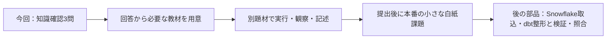

# d_01：CSVの入力値と再実行の知識確認

現在の段階：最初の3問を受領し、K02・K03は今回の問題の範囲で確認済みです。K01は要学習なので解説を用意しました。次は解説を読み、未確認のK04〜K06へ回答します。ハンズオンの操作手順・採点表・本番の白紙仕様はまだ公開していません。

| 今やること | 読む場所 | 提出するもの | 扱い |
|---|---|---|---|
| K01の要学習を読む | [bytes・str・型の名前](guide/01-bytes-and-text.md) | 読了の提出は不要。読んだだけで習得済みにはしない | 解説 |
| K04：CSVの構造を確認 | [次の知識確認](knowledge-check-02.md#k04) | 出力2行と理由1文、または分からない | 採点しない知識確認 |
| K05：読み取り後の値を確認 | [次の知識確認](knowledge-check-02.md#k05) | 出力・型の区別・理由、または分からない | 採点しない知識確認 |
| K06：読み取りを確認 | [次の知識確認](knowledge-check-02.md#k06) | 出力2行と理由1文、または分からない | 採点しない知識確認 |

## 目次

- [今回の到達点と位置づけ](#今回の到達点と位置づけ)

- [回答のしかた](#回答のしかた)

- [K01](#k01)

- [K02](#k02)

- [K03](#k03)

- [担当と次の段階](#担当と次の段階)

- [環境の準備について](#環境の準備について)

- [Gitの進め方](#gitの進め方)

- [用語](#用語)

## 今回の到達点と位置づけ

先に提案した「CSVを読み、元の値を保って内容を確認する」部品の学習を準備します。文字・欠損・実行順を確認し、回答後に必要な教材を分けます。CSVの取り込みは、今後のSnowflakeへの元データの保存、dbtの変換・品質テストにつなぐ入口です。

今回はローカルで進め、Snowflakeへの接続・データ保存・dbtの実行は行いません。無料トライアルが使えることと、課金不可の条件は確認済みです。Excelと2ファイルの照合は、この3問の要件には含めません。



## 回答のしかた

最初の3問の回答は[本人のnodes.md](nodes.md)で受領しています。ファイル名の変更や、初回の回答の書き直しは不要です。次の回答は同ファイルの末尾へK04〜K06として追記するか、チャットで番号を付けて送ってください。分からないところは「分からない」で大丈夫です。実行せず予想だけで回答できます。本人の回答と観察結果をAIが代筆することはありません。

資料を見たりコードを実行した場合は、本人が `tasks/d_01/submit/notes.md` を作り、知識確認の段階と分かる形で、見た資料・操作・入力・結果を1行ずつ残してください。実行した結果と予想は区別してください。コードの変更や本番実装はまだ求めません。

## K01

次のコードが出力する1行を予想してください。`raw` と `text` の違いも1文で説明してください。

```python
# AI担当：知識確認用の別題材コード。課題の解答ではない。
raw = b"rain"
text = "rain"
print(type(raw).__name__, type(text).__name__)
```

## K02

次のコードが出力する1行を予想してください。空文字 `""` と `None` の違いも1文で説明してください。

```python
# AI担当：知識確認用の別題材コード。課題の解答ではない。
values = ["", "0", None]
print([value is None for value in values])
```

## K03

次のStreamlitアプリを開き、`Add` を押して処理が終わった後、もう一度 `Add` を押したとします。2回目の操作が終わった時の表示は何になりますか。理由を1〜2文で説明してください。

```python
# AI担当：実行順を確認する別題材コード。本番の解答ではない。
import streamlit as st

count = 0
if st.button("Add"):
    count += 1
st.write(count)
```

## 担当と次の段階

| 対象 | 担当 | 現在の状態 |
|---|---|---|
| 技術検証と記録 | AI | [検証記録](verification.md)を作成済み |
| 知識確認の問題と状態の記録 | AI | [knowledge.md](knowledge.md)へK02・K03の確認を記録。[K04〜K06](knowledge-check-02.md)を公開 |
| 問題への回答と、実行・参照した記録 | 本人 | 初回3問は受領済み。次はK04〜K06。実行・参照の有無は本人の記録で確認 |
| 別題材の教材と操作手順 | AI | K01の[解説](guide/01-bytes-and-text.md)を公開。ハンズオンの操作・変更・観察手順は[下書き](drafts/handson-plan.md)まで |
| ハンズオンの操作・変更・観察・記述 | 本人 | 未出題 |
| 本番の白紙実装 | 本人 | ハンズオン完了・提出後に仕様を公開する |

この知識確認には合否を付けません。回答後も必要な項目を少数ずつ確認し、経験の自己申告だけで習得済みにはしません。まだ存在しないハンズオンや白紙段階を不合格・完了として扱いません。

## 環境の準備について

今の回答にインストールやサーバー起動は不要です。AIはこのMacの独立仮想環境で検証済みです。環境設定を本人の学習量や採点対象に数えません。

後で環境を再現する場合の操作は、プロジェクトのルートで以下を1操作ずつ行います。実施時にはAIがその段階の教材と合わせて案内します。

1. 既存Pythonで独立環境を作ります。

   ```sh
   uv venv --python /usr/local/bin/python3 .venv
   ```

2. 固定された依存だけを導入します。

   ```sh
   uv pip sync --python .venv/bin/python --require-hashes requirements.lock
   ```

3. 実際の版を確認します。

   ```sh
   .venv/bin/python -c 'import streamlit, pandas; print(streamlit.__version__, pandas.__version__)'
   ```

Python 3.12.0、Streamlit 1.67.0、pandas 3.1.1を検証しました。手順1のPythonの場所はこのMacで確認したものです。別環境の起動を検証済みとは扱いません。ハンズオンのアプリはまだないため、今は起動コマンドを実行しません。

## Gitの進め方

`task/d_01` を使います。知識確認からハンズオン・白紙・レビューまで同じブランチで進めます。今はPRを作成・マージする段階ではありません。課題全体のレビューと修正の後、本人が記述したPR本文ファイルを使う具体的な作成コマンドをAIが渡し、本人がPRを作成・マージします。次の課題はその後です。

AIは対象のファイルだけをcommit・pushします。本人が変更したコード・回答・観察記録はAIが書き換えません。

## 用語

| 用語 | 平易な説明 |
|---|---|
| 知識確認 | 教材を調整するために、今説明・予想できることを確かめる段階 |
| 型 | 値をどの種類のものとして扱うかを表す情報 |
| 再実行 | 操作などをきっかけにスクリプトが再び実行されること |
| 仮想環境 | このプロジェクト用のPythonパッケージを独立させる場所 |
