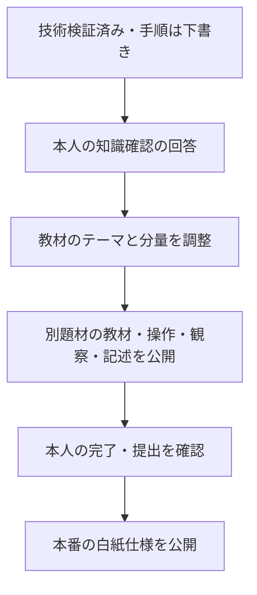

# d_01の手順の下書き

現在の状態：AIの準備用です。K01の回答を根拠にbytes・strの解説は作成しました。K02・K03は今回の問題の範囲で確認済みです。2026-11-14にK04〜K06を受領し、CSVの構造・セルと型推論・読み取り位置の解説も作成しました。残るK07・K08は確認中なので、ハンズオンの実行手順・変更するコード・観察の設問・採点基準はまだ確定しません。

## 目次

- [別題材と分け方](#別題材と分け方)

- [必要なテーマ](#必要なテーマ)

- [公開条件](#公開条件)

## 別題材と分け方

本番はCSV・Excelの整形・照合ツールの入力部分です。別題材では架空の観測記録をCLIで読む練習と、別のカウンター画面で実行順を調べる練習に分けます。名前を変えるだけで本番のアップロードとプレビューが完成するアプリを教材にはしません。

| 練習の下書き | 教えるテーマ | まだ用意しないもの |
|---|---|---|
| CLIで観測記録の入力を読む | バイト・文字、CSVの構造、読み取り前後の値、失敗時 | 本番用のアップロードから表表示までを完成させる関数 |
| カウンター画面の実行を調べる | 通常変数、再実行、状態の保持 | 本番の状態設計や、そのまま使える解答骨格 |
| 記述で処理の流れを説明する | 見た入力・実行・出力と一般的な説明の区別 | 本人の観察結果や設計判断の回答文 |

## 必要なテーマ

| 分けるテーマの案 | 必要知識ID | 作成時に含めること |
|---|---|---|
| ファイルの中身と文字 | K01、K06 | 具体例、入力の型、読み取り位置 |
| CSVの構造と読み取り | K02、K04、K05 | 引用符、ヘッダー、空欄、0行と0バイトの違い、順序 |
| 操作と実行順 | K03、K08 | 初期表示、別の操作、再実行、保持するもの |
| 読めない入力 | K07 | エラーが起きる場所、処理の中断、利用者への表示 |

知識確認で要学習と確認できたテーマだけを教材として分けます。未確認は、必要に応じて少数ずつ追加確認します。

## 公開条件

ハンズオンを公開する時にやること表と採点表を固定します。現段階で未出題の操作・記述・白紙実装を評価しません。本番要件のAIによる一時検証実装を教材や本番コードとして配布しません。
