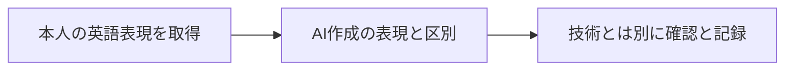

# d_01の英語の記録

現在は知識確認の開始段階で、本人が作った英語の提出物は取得していません。英語の評価は技術の確認と区別します。

| 対象 | 現在の状態 | 扱い |
|---|---|---|
| 本人のPRタイトル・本文 | 未作成・未取得 | 英語力を評価しない |
| 本人のコミットメッセージ | 未取得 | AIのコミットを本人の実力に算入しない |
| 本人のコード内の英語 | 未取得 | 診断コード内のAdd等はAI作成で、本人の実力に算入しない |

本人の英語を取得した段階で、その出典と根拠を記録します。現在の未取得を不合格や弱点にはしません。
