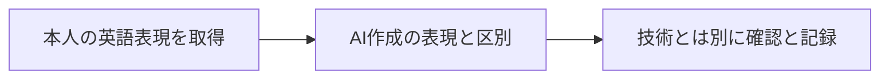

# d_01の英語の記録

2026-11-16、nodes.mdの全8項目の回答を受領しました。本人の説明は日本語で、貼り付けられた問題コードはAIが作った出題文です。本人が作った英語表現の評価対象はありません。英語の評価は技術の確認と区別します。

| 対象 | 現在の状態 | 扱い |
|---|---|---|
| 本人のPRタイトル・本文 | 未作成・未取得 | 英語力を評価しない |
| 本人のコミットメッセージ | 未取得 | AIのコミットを本人の実力に算入しない |
| 本人のコード内の英語 | 今回の対象なし | nodes.md内のコードは元のAI作成の問題で、Add等を本人の実力に算入しない |

本人の英語を取得した段階で、その出典と根拠を記録します。現在の未取得を不合格や弱点にはしません。ハンズオンのコードと文言はAI作成であり、今後も本人が作った英語と区別します。
