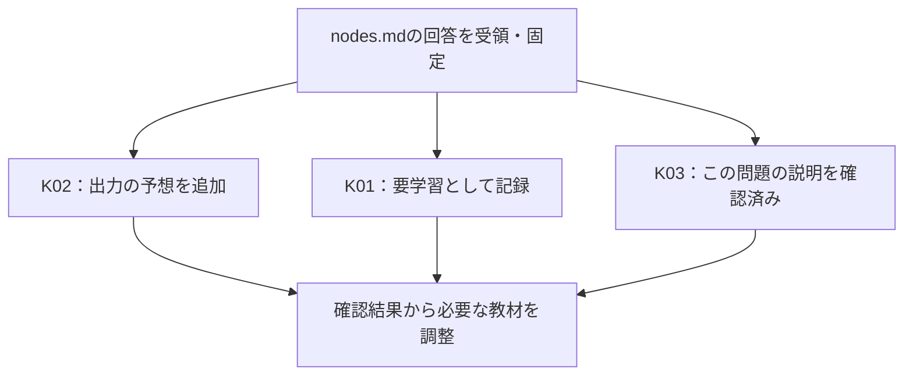

# d_01の初回の回答確認

2026-11-13、本人が「nodes.mdに入れました」と提出範囲を明示したため、そのファイルだけを確認しました。現在は採点しない知識確認の段階です。ハンズオンや白紙実装の合否は付けません。

## 目次

- [提出時点](#提出時点)

- [確認状況](#確認状況)

- [今の追加](#今の追加)

## 提出時点

| 項目 | 記録 |
|---|---|
| 対象 | [本人のnodes.md](../nodes.md) |
| 提出を固定したコミット | a9228bf |
| SHA-256 | 70bffa090b27eef85d5b322af4a36bb207c8713146cde4f0681066dcab334a33 |
| AIの操作 | 読み取りと対象ファイルのコミット。本文の修正・移動・名前変更はしない |
| 実行・参照の記録 | 今回のファイルにはなし。実行した・資料を見たとは推測しない |

## 確認状況

| ID | 受け取った根拠 | 記録する状態 |
|---|---|---|
| K01 | 10〜17行にbytes・str・型名の説明と、__name__を知らないという申告がある | bytesをstrとする説明などに整理が必要。要学習として教材へつなげ、今は正答への書き直しを求めない |
| K02 | 27〜29行に空文字とNoneの区別の説明がある | 出力の予想は未記入。コードの出力の理解は未確認。未提出を誤答にしない |
| K03 | 43行に2回目の表示と、再実行時の初期化の理由がある | この問題の再実行の説明を確認済み。Session State全般や実際の操作まで確認済みにはしない |

本人の理解度の記録は[knowledge.md](../knowledge.md)、英語の記録は[english.md](../english.md)に分けます。

## 今の追加

K02のコードが出力する1行だけ、本人が追記するかチャットで送ります。予想できなければ「分からない」と回答できます。K01・K03の再提出、ファイル名の変更、環境導入や本番コードの作成は現在の追加要件にはしません。

資料を見たりコードを実行した場合だけ、既に公開した手順に沿って、本人が `tasks/d_01/submit/notes.md` に参照・操作・入力・結果を残します。AIはその記録を代筆しません。

