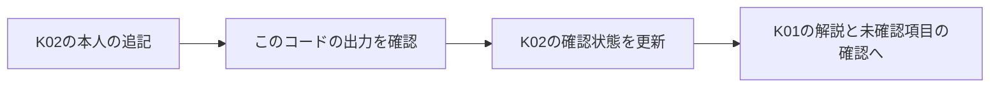

# d_01：K02の追記確認

2026-11-13、本人が追記を申告したため、nodes.mdのK02の差分だけを確認しました。採点しない知識確認で、本人の文章は変更していません。

| 項目 | 確認した内容 |
|---|---|
| 提出時点 | コミット9b0aa3e |
| 本人のファイル | [nodes.md](../nodes.md) |
| SHA-256 | 51a7d3f8bdb883035984977f124adac1166c86af509c8a1b1f14c47fc1049b67 |
| 差分 | K02へ出力予想を追加 |
| K02の確認 | 提出されたリストの真偽値と順序は、今回のコードの出力と一致。空文字とNoneの区別の説明も受領済み |
| 記録する範囲 | K02のこのコードの出力と区別を確認済み。CSVやpandasの欠けた値の扱い全般を確認したことにはしない |
| 継続する項目 | K01は要学習、K03はこの問題の説明を確認済み。K04以降は未確認 |

最初の3問について追加の書き直しは求めません。次は[bytes・strの解説](../guide/01-bytes-and-text.md)を読み、[K04〜K06](../knowledge-check-02.md)へ回答します。まだ本番コードの実装やPR作成は行う段階ではありません。
