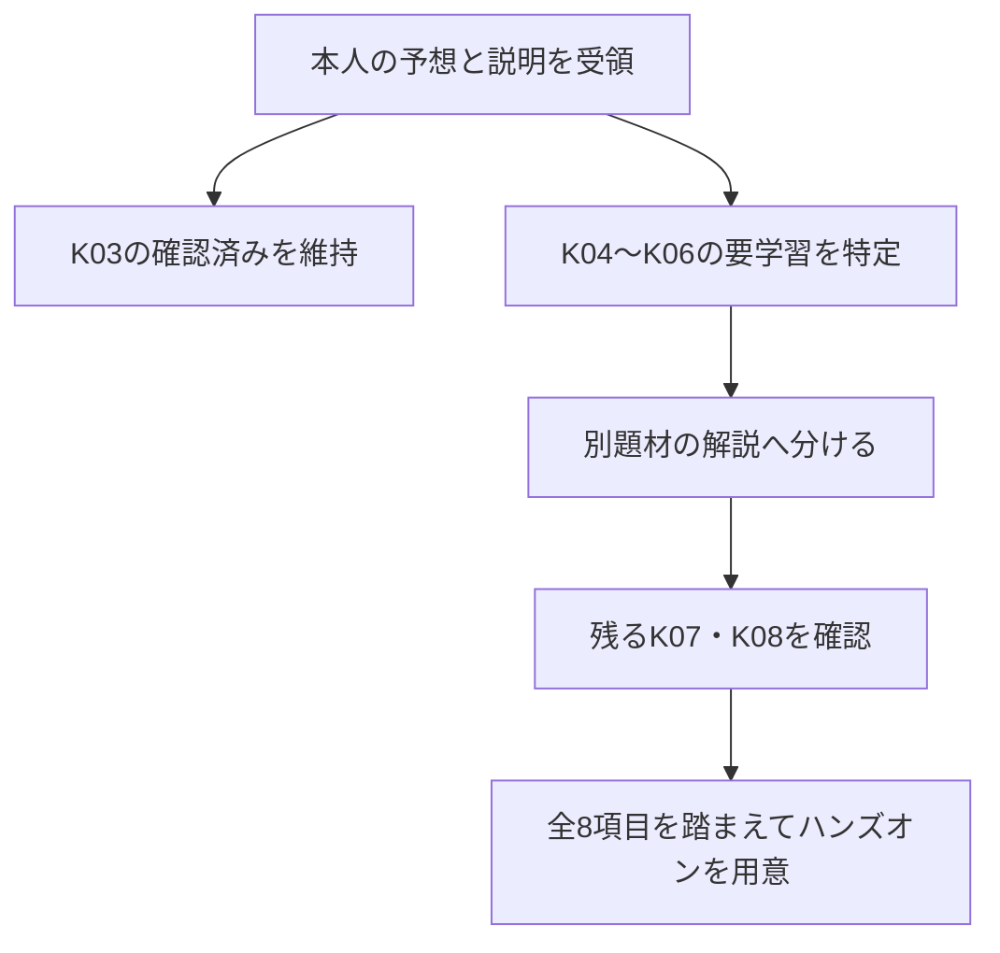

# d_01：K03〜K06の回答確認

2026-11-14、本人の提出申告を受け、nodes.mdを確認しました。差分はK04〜K06の追記で、K03の記述は前回と同じです。本人の回答は変更せず、コミットac89473で提出時点を固定しました。採点しない知識確認のため、合否や得点は付けません。

## 目次

- [提出と実行の根拠](#提出と実行の根拠)

- [確認結果](#確認結果)

- [学ぶポイントと次の作業](#学ぶポイントと次の作業)

## 提出と実行の根拠

| 項目 | 記録 |
|---|---|
| 本人のファイル | [nodes.md](../nodes.md) |
| 提出コミット | ac89473 |
| SHA-256 | e74f578ad64afe1eebc672548ec44794fbe8ad30eb80a68533de8decdf3b1d43 |
| AIの実行 | 2026-11-14、このプロジェクトのルートで `.venv/bin/python` にK04〜K06のコードを渡して実行 |
| 実行環境 | Python 3.12.0、pandas 3.1.1 |
| 本人の操作・参照 | nodes.mdに予想と説明を受領。本人が実行した結果や参照先は未確認で、推測しない |

## 確認結果

| ID | 本人の記述の確認 | AIの実測と整理 | 知識の状態 |
|---|---|---|---|
| K03 | 2回目は1、再実行時にcountが0から始まるという説明 | 既に確認したコードの動作と整合。今回の差分による変更なし | この問題の説明は確認済みを維持 |
| K04 | len(rows)を2、len(rows[1])を16文字と予想 | 出力は上から2、2。rows[1]は文字列ではなく、フィールド2個のリスト。行の総数の予想は合っている | 行・フィールド・文字列の区別が要学習 |
| K05 | locの結果を1行分のリストと予想 | 出力は数値4。この環境ではnumpy.int64。locで行・列を一つずつ指定し、1セルを取り出している。読み取り時に型が推測される | セルの選択と型推論が要学習 |
| K06 | 2回とも同様の内容を表示すると予想 | 上からbytesの `b'sun'`、空のbytesの `b''`。最初のread後に位置は末尾の3となる | バイト列と読み取り位置が要学習 |

K04で触れた改行設定については、テキスト層での改行の扱いとcsv.readerの解析を分けて学びます。K05の補足では、標準のcsv.readerもCSVの区切り・引用符を解析する点を整理します。書き直しを求めるための指摘ではなく、教材の内容を決める根拠です。

## 学ぶポイントと次の作業

| 優先する整理 | 読む場所 |
|---|---|
| 文字列・行・表・セルで、何を取り出しているかを追う | [CSVの構造](../guide/02-csv-rows-and-fields.md)、[DataFrameと型推論](../guide/03-dataframe-and-inference.md) |
| 同じ入力を読む時に、どの位置から読み始めるかを追う | [BytesIOと読み取り位置](../guide/04-reading-position.md) |

今までの回答は修正不要です。読む入口は[解説一覧](../guide/README.md)、回答する問題は予告済みの[最後の2項目](../knowledge-check-03.md)です。本人の学習後の理解は後の操作・記述で確認します。PR作成・マージや次の課題への移行はまだ行いません。
