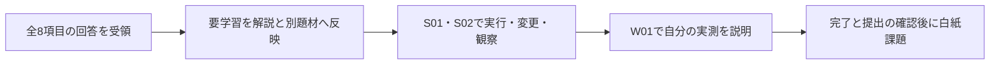

# d_01：K07・K08の回答確認と知識確認の終了

2026-11-16、本人の提出申告を受け、nodes.mdのK07・K08の追記を確認しました。本文は変更せず、12b8e79で提出時点を固定しました。これで知識確認K01〜K08の回答はすべて受領しました。合否や得点を付ける段階ではありません。

## 目次

- [提出と実測の根拠](#提出と実測の根拠)

- [確認結果](#確認結果)

- [次の段階](#次の段階)

## 提出と実測の根拠

| 項目 | 記録 |
|---|---|
| 本人の回答 | [nodes.md](../nodes.md) |
| 提出コミット | 12b8e79 |
| SHA-256 | 3d565279ac611b2df567a8bbd2a26753fbd63fa2c026895a3f683c4361615df4 |
| AIの実行 | 2026-11-16、プロジェクトのルートで `.venv/bin/python` に診断コードを渡して実行 |
| 環境 | Python 3.12.0、Streamlit 1.67.0。K08はAppTestで同一セッションの初期表示と2回の操作を確認 |
| 本人の実測 | 予想と説明を受領。本人の操作・参照の記録はまだ確認しておらず、推測しない |

## 確認結果

| ID | 本人の説明から分かること | AIの実測と整理 | 状態 |
|---|---|---|---|
| K07 | intへの変換ができない入力だと分かっている。exceptの時点で例外が出て後ろが止まると説明 | 例外が起きるのはintの行。指定のexceptが受け取り、invalidの後にdoneも表示される | 例外の発生位置、処理する分岐、処理後の継続が要学習 |
| K08 | キーがなければ初期化すること、別タブが別セッションになることを説明 | 問題は同じタブでの2回の操作。キーは同一セッションに保持され、2回目の保存値と表示は2 | 同じセッションの再実行と別セッションの違いが要学習 |

本人の記述の修正や追加の知識確認は求めません。K01・K04・K05・K06・K07・K08は教材で扱い、K02・K03は今回の問題の範囲で確認済みを維持します。読んだことや教材が動いたことだけを習得済みにしません。

## 次の段階

[ハンズオン](../guide/handson.md)のS01・S02・W01へ進みます。本人が教材を実行・変更し、観察と説明を提出します。本番のCSVプレビューは、ハンズオンの完了申告と提出を確認した後に白紙仕様を公開します。

