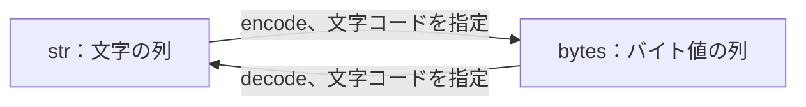
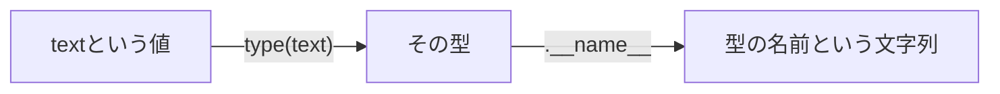

# bytes・str・型の名前

要点：`str` は文字の列、`bytes` はバイト値の列です。文字をバイトにする時は文字コードを決めます。`type()` は型そのものを返し、型の `__name__` は型の名前を表す文字列です。

K01の回答から整理が必要と分かったテーマを説明します。現在の知識確認を助ける解説で、本番のCSV読み込み関数や白紙課題の解答ではありません。読んだことだけでK01を習得済みにはしません。

## 目次

- [一つの文字を比べる](#一つの文字を比べる)

- [文字とバイトの関係](#文字とバイトの関係)

- [typeと__name__](#typeと__name__)

- [CSVを扱う時の位置づけ](#csvを扱う時の位置づけ)

- [任意の確認](#任意の確認)

- [実測と未確認](#実測と未確認)

- [用語](#用語)

## 一つの文字を比べる

次は海の観察メモを、文字とUTF-8のバイト列で持つ例です。

```python
# AI担当：型と変換を説明する別題材の例。
text = "海"
raw = text.encode("utf-8")

print(type(text).__name__)
print(type(raw).__name__)
print(len(text))
print(len(raw))
print(raw)
print(raw.decode("utf-8"))
```

2026-11-13、このMacのPython 3.12.0でAIが実行した出力です。本人の観察結果ではありません。

```text
str
bytes
1
3
b'\xe6\xb5\xb7'
海
```

この例では、同じ「海」を表す時も、文字の列は長さ1、UTF-8のバイト列は長さ3です。`b'...'` の表示はbytesの表現です。表示に含まれる `\xe6` などは、バイト値を16進数で表したものです。

## 文字とバイトの関係

| 対象 | 意味 | 今回の例 |
|---|---|---|
| str | Unicodeの文字の列 | `"海"` |
| bytes | 0〜255のバイト値の列 | `text.encode("utf-8")` の結果 |
| encode | 指定した文字コードでstrをbytesにする操作 | `text.encode("utf-8")` |
| decode | 指定した文字コードでbytesをstrにする操作 | `raw.decode("utf-8")` |

`b"sea"` と書いた値は、初めからbytesとして作られます。「str型の値にbという印が付いている」という扱いではありません。既にあるstrをbytesへ変える操作は `encode()` です。



バイト列を文字として読む時は、作成時の文字コードを知る必要があります。bytesには画像などのデータも入るので、どのbytesでも文字として読めるわけではありません。初回のCSVでは、まず扱う文字コードの範囲を決めて学びます。

`len(str)` はUnicodeコードポイントの数、`len(bytes)` はバイト数を返します。見た目の文字数とコードポイント数が違う場合もありますが、今回の「海」は1コードポイントです。

公式の説明：[str.encode](https://docs.python.org/3.12/library/stdtypes.html#str.encode)、[bytes.decode](https://docs.python.org/3.12/library/stdtypes.html#bytes.decode)。2026-11-13参照。

## typeと__name__

同じ `text = "海"` に対して、次を比べます。

```python
# AI担当：型そのものと型の名前を比べる説明例。
text = "海"
print(type(text))
print(type(text).__name__)
```

AIがPython 3.12.0で確認した出力です。

```text
<class 'str'>
str
```

`type(text)` はtextの型を返します。型もPythonのオブジェクトなので、名前などの情報を持っています。その `__name__` を読むと、ここでは `"str"` という文字列が得られます。`__name__` 自体が値を別の型へ変換するわけではありません。



Pythonの組み込み型の名前は、今回なら `str` と `bytes` です。`String` や `Byte` という表記とは区別します。

公式の説明：[type](https://docs.python.org/3.12/library/functions.html#type)、[オブジェクト・値・型](https://docs.python.org/3.12/reference/datamodel.html#objects-values-and-types)。2026-11-13参照。`__name__` の具体例は上記の実測で確認しています。

## CSVを扱う時の位置づけ

ファイルのバイト列を受け取り、文字コードに従って文字として解釈し、CSVの行と列を読み取る、という役割の違いがあります。これらを一つの「文字列」という言葉だけで扱うと、どの段階で何が変わったか追いにくくなります。

この区別は、後にSnowflakeへ保存する前の入力確認や、dbtへ渡すデータの前提を説明する土台になります。具体的な本番の変換方法や設計は、学習後の白紙課題で本人が組み立てます。

## 任意の確認

以下は採点対象外・提出不要の確認です。本番のコードはまだ作りません。

1. 最初の例の `"海"` を `"A"` に変え、文字とバイトの長さを比べます。

2. `"海"` を空文字 `""` に変え、型と長さを比べます。

実行した場合は、本人が参照・操作・入力・結果を `tasks/d_01/submit/notes.md` に記録します。ここには本人の観察の結論は用意していません。

## 実測と未確認

| 項目 | 状態 |
|---|---|
| 実施者・日付 | AI、2026-11-13 |
| 場所・環境 | このプロジェクトのルート、`.venv/bin/python`、Python 3.12.0 |
| 実行方法 | `.venv/bin/python` に上記の別題材の例を渡して実行 |
| 確認した入力 | 海、sky、空文字、空 |
| 確認結果 | 海の型・長さ・バイト表現・復号と、別入力のUTF-8の変換の往復を確認 |
| 本人の理解 | この解説を読んだ後の説明や操作は未確認。後のハンズオン等で確認 |
| 本番 | CSVプレビューの本人の実装は未作成・未検証 |

## 用語

| 用語 | 平易な説明 |
|---|---|
| バイト | 0〜255の値を表せるデータの単位 |
| Unicode | 多様な文字に番号を割り当てる仕組み |
| コードポイント | Unicodeで文字などに割り当てた番号 |
| UTF-8 | Unicodeの内容をバイト列として表す方式の一つ |
| リテラル | `"海"` や `b"sea"` のように、コードへ直接書いた値 |
| 型 | 値の種類と、どの操作ができるかを表すもの |
| 属性 | オブジェクトが持ち、ドットを付けて読み取れる情報 |
