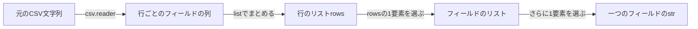

# CSVの行・フィールド・文字列

要点：`csv.reader` から得た1行は、フィールドの文字列を並べたリストです。その行に対する `len()` はフィールド数を数えます。

K04の回答で、読み取り後の行と元の文字列を整理する必要があると分かりました。ここでは別の観測メモを使います。本番コードや本人の観察結果は用意しません。

## 目次

- [具体例と実測](#具体例と実測)

- [何を数えているか](#何を数えているか)

- [引用符と改行](#引用符と改行)

- [任意の確認と未確認](#任意の確認と未確認)

- [用語](#用語)

## 具体例と実測

```python
# AI担当：CSVの構造を説明する別題材の例。
import csv
from io import StringIO

sample = 'point,note\nB,"clear, warm"\n'
rows = list(csv.reader(StringIO(sample, newline="")))
print(rows)
print(len(rows[1]))
```

2026-11-14、このプロジェクトのルートで `.venv/bin/python`（Python 3.12.0）に例を渡し、AIが実行した出力です。

```text
[['point', 'note'], ['B', 'clear, warm']]
2
```

## 何を数えているか

| 式 | 扱っているもの | lenを使う場合の対象 |
|---|---|---|
| `sample` | 元のstr | 文字列の長さ |
| `rows` | 読み取り後の行のリスト | 行の数。標準のcsv.readerはヘッダーも1行として返す |
| `rows[1]` | 2行目のフィールドのリスト | フィールドの数 |
| `rows[1][1]` | 一つのフィールドのstr | その文字列の長さ |

同じ `len()` でも、渡すものの型によって数えている対象が変わります。`csv.reader` で分けた後の行には、区切りのカンマや行末の改行を含む元の行文字列がそのまま入るわけではありません。



## 引用符と改行

例の `"clear, warm"` にあるカンマは、一つのフィールドの中身です。CSVの引用符のルールを理解して読むため、単にカンマごとに文字列を切る処理とは結果が異なる場合があります。標準の `csv.reader` もCSVを解析します。

`newline=""` は、CSVの読み取り側が改行を扱えるように、テキスト層での改行変換を避けるための指定です。「CRは改行として認めない」という意味ではありません。AIはこの例の入力経路でLF・CRLF・CRの3種類の行末も確認しました。引用符の中に改行が入る場合もあるので、常に「物理的な1行が1レコード」とは限りません。

参考：[Python公式csv](https://docs.python.org/3.12/library/csv.html)、[StringIO](https://docs.python.org/3.12/library/io.html#io.StringIO)。2026-11-14確認。

## 任意の確認と未確認

採点対象外・提出不要の確認として、例のメモをカンマのない文字列に変え、元の文字列と読み取り後の構造を比べられます。実行した場合は本人が `submit/notes.md` に入力・操作・結果を残します。

| 対象 | 状態 |
|---|---|
| AIの実測 | 上記の例とLF・CRLF・CRをPython 3.12.0で確認 |
| 本人の理解 | 読了だけでは確認済みにしない。後のハンズオンで確認 |
| 本番の入力処理 | 本人の実装と接続は未検証 |

## 用語

| 用語 | 平易な説明 |
|---|---|
| フィールド | CSVの一つの項目の値 |
| ヘッダー | 列名を並べた先頭の行 |
| レコード | 一件のデータを表す項目のまとまり |
| CR・LF | 改行に使われる制御文字。CRLFは二つの組み合わせ |
