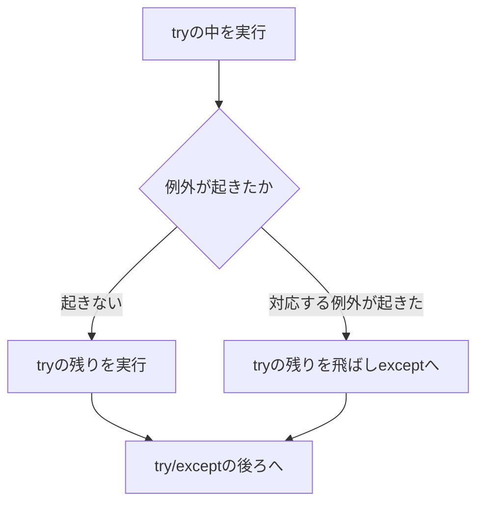

# 例外が起きる場所と、その後の処理

要点：例外は処理の途中で発生します。対応するexceptがあれば、そのブロックを実行した後、try/exceptの後ろへ進みます。K07で整理が必要と分かった内容です。

## 目次

- [別題材の例と実測](#別題材の例と実測)

- [処理を追う](#処理を追う)

- [教材で確認する場所](#教材で確認する場所)

- [未確認と用語](#未確認と用語)

## 別題材の例と実測

```python
# AI担当：短い計測値を使う例外の説明例。
for message in ["7", "x"]:
    try:
        print("converted", int(message))
    except ValueError:
        print("invalid value")
    print("after block")
```

2026-11-16、このプロジェクトのルートで `.venv/bin/python`（Python 3.12.0）へ例を渡し、AIが実行した出力です。

```text
converted 7
after block
invalid value
after block
```

## 処理を追う

`int(message)` が文字列を整数へ変えようとします。変えられない入力では、その行の評価中にValueErrorが起きます。exceptは、その例外の型が一致する時に実行する処理を指定します。



対応するexceptがない場合は、その例外が外へ伝わります。処理されなければ実行はエラーで止まります。今回のK07ではintの行で起きたValueErrorを指定のexceptが受け取るため、その後ろのprintにも進みます。

参考：[Python公式・例外を処理する](https://docs.python.org/3.12/tutorial/errors.html#handling-exceptions)。2026-11-16確認。

## 教材で確認する場所

[Streamlit教材](../handson/state_lab.py)のApplyの中で、数値への変換、値の更新、エラーの表示の順を追います。tryより後ろにある画面表示にも注目します。具体的な操作と提出条件は[ハンズオン](handson.md#s02メモファイルと状態を調べる)に固定しています。

任意の確認として、上の説明例の入力を別の数値の文字列に変えて実行できます。採点対象外・提出不要で、実行した場合は本人が `submit/notes.md` に記録します。

## 未確認と用語

| 対象 | 状態 |
|---|---|
| AIの実測 | 数値にできる入力・できない入力で上記の流れを確認 |
| 本人の理解 | 解説を読んだだけでは確認済みにしない。ハンズオンの操作・記述で確認 |

| 用語 | 平易な説明 |
|---|---|
| 例外 | 実行中に通常の処理を続けられないことを知らせるもの |
| try | 例外を扱う対象の処理を書く部分 |
| except | 指定した種類の例外が起きた時に実行する部分 |
