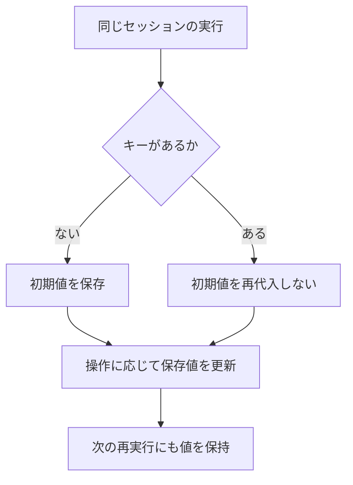

# 同じセッションの再実行と状態の保持

要点：同じタブでの操作による再実行では、通常の変数はコードに従って作り直されます。Session Stateの値は同じセッションで保持され、キーが存在する間は「未登録なら初期化」の分岐を通りません。K08で整理が必要と分かった内容です。

## 目次

- [K08で確認した条件](#k08で確認した条件)

- [初期化と更新を分ける](#初期化と更新を分ける)

- [教材で確認する場所](#教材で確認する場所)

- [実測と用語](#実測と用語)

## K08で確認した条件

問題は同じブラウザタブで、切断やページの再読み込みをせずにVisitを2回押す条件でした。別々のセッションを開く条件とは区別します。

| 場面 | 確認する対象 |
|---|---|
| 同じタブの操作による再実行 | 既にあるSession Stateのキーと値 |
| 初めて開いた別のタブ | 別のセッションのキーと値 |
| 通常の変数への代入 | 毎回その代入を実行する位置 |

K08は2026-11-16にStreamlit 1.67.0のAppTestで再実行しました。初期表示の後、同じセッションで2回操作した時の保存値と表示は2でした。本人の実ブラウザでの観察結果ではありません。

## 初期化と更新を分ける

K08では1回目の実行でvisitsを用意し、クリックのたびに同じキーの値を更新します。2回目の操作の前にもキーは存在します。別タブという説明の一部は合っていますが、今回の問題で指定した操作条件へ当てはめる必要がありました。

Session Stateは、後にSnowflakeへ保存する永続的なデータと同じものとして扱いません。今回のハンズオンでは、同じタブの操作と新しいタブの操作の違いを観察します。

参考：[Streamlit公式Session State](https://docs.streamlit.io/develop/api-reference/caching-and-state/st.session_state)。2026-11-16確認。

## 教材で確認する場所

[Streamlit教材](../handson/state_lab.py)では、通常変数と保存した値を同時に表示します。INITIAL_COUNTは初期値です。既存のキーの値を変えるResetボタンの処理と、キーがない時だけ実行する初期化を分けて読んでください。

具体的な操作と提出条件は[ハンズオン](handson.md#s02メモファイルと状態を調べる)です。この説明文書には、本人が行う変更前後の観察結果や回答文を用意していません。

## 実測と用語

| 対象 | 状態 |
|---|---|
| AIの実測 | K08の同一セッションの初期表示と2回の操作をAppTestで確認 |
| 本人の理解 | 同じタブと別タブでの観察・記述はこれから確認 |

| 用語 | 平易な説明 |
|---|---|
| 再実行 | 操作などをきっかけにスクリプトが再び実行されること |
| セッション | 利用者の一連の接続・操作を区別する単位 |
| キー | Session Stateの値を識別する名前 |
| 初期化 | 初めに使う値を用意すること |
