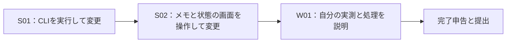

# d_01の学習とハンズオンの入口

知識確認K01〜K08はすべて受領しました。追加の知識確認はありません。次は、要学習に対応する解説を参照しながら、別題材のハンズオンを実行・変更・観察して記述します。

## 目次

- [最初に開く手順](#最初に開く手順)

- [操作に対応する解説](#操作に対応する解説)

- [提出と次の段階](#提出と次の段階)

## 最初に開く手順

[ハンズオンの手順](handson.md)を開き、S01、S02、W01の順に進めます。全ての解説を読んでから始める必要はなく、手順ごとに示した章を参照できます。

## 操作に対応する解説

| 解説 | 主な操作・知識 |
|---|---|
| [bytes・str・型の名前](01-bytes-and-text.md) | S01の文字とバイト、K01 |
| [CSVの行・フィールド・文字列](02-csv-rows-and-fields.md) | S01の構造、K04 |
| [DataFrameのセルと型推論](03-dataframe-and-inference.md) | S01の値と型・空欄、K05 |
| [BytesIOと読み取り位置](04-reading-position.md) | S01の読み取り位置とS02のファイル入力、K06 |
| [例外が起きる場所とその後](05-exceptions.md) | S02の不正な入力、K07 |
| [同じセッションの再実行と状態](06-reruns-and-state.md) | S02の同一タブ・別タブ、K03・K08 |

例は別題材の説明で、本人の観察記録ではありません。各解説末尾の任意の確認は採点対象外です。採点する操作と記述は、ハンズオンのS01・S02・W01に固定しています。

## 提出と次の段階

本人が `submit/notes.md` へ参照・操作・入力・観察結果、`submit/answers.md` へW01の回答を書きます。AIは本人の回答と観察結果を作成・上書きしません。詳しい提出物はハンズオン末尾で確認してください。

ハンズオン全体の完了申告と提出を確認後、本番の小さな白紙課題の仕様を公開します。同じtask/d_01で続け、課題全体のレビュー・修正の後に本人がPRを作成・マージします。
