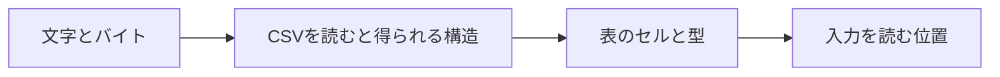

# d_01の解説を読む順序

K01・K04・K05・K06の回答を根拠に、要学習を次のテーマへ分けました。読んだだけでは習得済みにしません。現段階ではハンズオンの操作・変更・観察・記述の採点表は未公開です。

## 目次

- [読む順序](#読む順序)

- [次の確認](#次の確認)

## 読む順序

| 順序 | テーマ | 対応する知識 |
|---|---|---|
| 1 | [bytes・str・型の名前](01-bytes-and-text.md) | K01 |
| 2 | [CSVの行・フィールド・文字列](02-csv-rows-and-fields.md) | K04 |
| 3 | [DataFrameのセルと型推論](03-dataframe-and-inference.md) | K05 |
| 4 | [BytesIOと読み取り位置](04-reading-position.md) | K06 |

例は別題材の説明で、本人の観察記録ではありません。任意の確認は採点対象外です。実行・参照した場合は本人が `submit/notes.md` に記録します。

## 次の確認

知識確認は[第3回のK07・K08](../knowledge-check-03.md)が最後です。分からない場合は「分からない」と回答できます。全8項目の回答が揃ったら、要学習を反映した別題材のハンズオンを用意します。課題01の範囲を超える問題を追加する場合は先に相談します。
