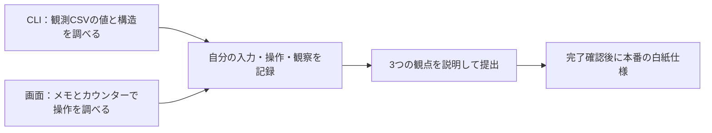

# d_01：別題材で読む・変える・観察する

現在の段階はハンズオンと記述です。知識確認K01〜K08はすべて受領しました。追加の知識確認はありません。この手順のS01・S02・W01を終えて提出した後、本番の小さなCSVプレビューの白紙仕様を公開します。

| やることID | 本人が行うこと | 提出するもの |
|---|---|---|
| S01 | CLI教材を変更前・変更後に実行し、値・型・構造・読み取り位置を観察する | reading_lab.pyの指定変更、変更前後の出力、notes.mdの入力・操作・観察記録 |
| S02 | Streamlit教材でファイル入力・同じタブと別タブの状態・不正な数値入力を観察し、初期値も変更する | state_lab.pyの指定変更、notes.mdの操作と表示の記録 |
| W01 | 下記の3つの観点を、自分の実測と教材の処理を対応させて説明する | submit/answers.mdにa・b・cの短い説明 |

## 目次

- [今回の条件と担当](#今回の条件と担当)

- [S01：観測記録をCLIで調べる](#s01観測記録をcliで調べる)

- [S02：メモファイルと状態を調べる](#s02メモファイルと状態を調べる)

- [W01：実測と処理を結び付ける](#w01実測と処理を結び付ける)

- [提出と次の段階](#提出と次の段階)

- [困った時と未確認](#困った時と未確認)

- [用語](#用語)

## 今回の条件と担当

1. 本人が変更するのは、S01の2つの定数とS02の初期値の計3か所です。元の処理は残し、動くものを観察します。

2. 本人が入力・操作・表示の実測を `submit/notes.md` に残し、予想と実測を区別します。操作記録の書式は自由で、画面収録は不要です。

3. W01の回答を自分の言葉で書き、ハンズオン全体の完了を申告します。AIは本人の回答・観察結果を代筆しません。

AIが用意したコードは `handson/` の教材です。ハンズオンでは開いて変更できます。本番へコピーしたり、名前だけ変えて使ったりせず、後で学んだ技法を組み合わせます。今回はCSVをCLIで読む練習と、テキストのメモを扱う画面を分けてあり、本番のCSVアップロードと表表示を完成させるコードにはしていません。



環境はこのMacのプロジェクト内の `.venv` を用意済みです。以下のコマンドはプロジェクトのルートで実行します。Snowflake・dbt・有料APIへの接続や課金操作はありません。

## S01：観測記録をCLIで調べる

読む場所：[文字とバイト](01-bytes-and-text.md)、[CSVの構造](02-csv-rows-and-fields.md)、[表のセルと型推論](03-dataframe-and-inference.md)、[読み取り位置](04-reading-position.md)。出力で分からない部分に対応する章を参照してください。

1. `handson/reading_lab.py` を開き、元データ、最初に読むバイト数、標準CSVとpandasによる処理の位置を確認します。

2. 保存先のフォルダを作ります。

   ```sh
   # AI担当：本人が実測出力を保存するための場所を用意する操作。
   mkdir -p tasks/d_01/submit
   ```

3. 変更前の教材を実行し、出力を保存します。`tee` は表示した出力をファイルにも保存する補助操作です。

   ```sh
   # AI担当：本人が変更前の教材を実行して出力を保存する操作。
   .venv/bin/python tasks/d_01/handson/reading_lab.py | tee tasks/d_01/submit/reading-before.txt
   ```

4. 出力の4区分を読みます。型、読み取り位置、CSVの行とフィールド、型推論あり・値を保持する読み取りの違いを、実際に表示された値とともにnotes.mdへ記録します。

5. 同じファイルの `FIRST_SITE` を `"015"` から `"027"`、`READ_SIZE` を `3` から `7` に変更して保存します。

6. 変更後を実行し、別のファイルへ出力を保存します。

   ```sh
   # AI担当：本人が変更後の教材を実行して出力を保存する操作。
   .venv/bin/python tasks/d_01/handson/reading_lab.py | tee tasks/d_01/submit/reading-after.txt
   ```

7. 変更した入力、変わった表示、同じだった表示を、変更前後の実測を使ってnotes.mdへ記録します。理由の説明はW01で扱います。

元データの1件は観測地点1つの記録です。stationは識別用の文字列、noteはメモ、temperatureは読み取りの比較に使う入力です。文字列NA、空欄、数値として読める0もデータに含めています。ここでは記録の識別子の重複や順序を変える操作は要求しません。

## S02：メモファイルと状態を調べる

読む場所：[例外の処理](05-exceptions.md)、[再実行と状態](06-reruns-and-state.md)、[ファイル入力の値](04-reading-position.md#ファイル入力とgetvalue)。

この教材の `file_uploader` はファイル未選択ならNone、選択後はファイルのようなオブジェクトを返します。教材ではNoneを確認してから名前とgetvalueによるbytesを使います。メモの内容をCSVの表へ変換する処理はありません。

1. 別のターミナルで、教材をlocalhost限定で起動します。

   ```sh
   # AI担当：本人が教材をローカルだけに公開して起動する操作。
   .venv/bin/python -m streamlit run tasks/d_01/handson/state_lab.py --server.address=127.0.0.1 --server.port=18501 --server.headless=true --browser.gatherUsageStats=false
   ```

2. ブラウザで `http://127.0.0.1:18501` を開きます。ファイル未選択時の案内と、通常変数・保存した値の初期表示をnotes.mdへ記録します。

3. `handson/observation-note.txt` を選び、ファイル名、内容の型、バイト数を記録します。

4. 増やす数を `2` にしてResetを押し、Applyを2回、各処理の完了を待って押します。同じタブでの各操作後の通常変数・保存した値を記録します。

5. 増やす数を `oops` にし、Applyを押します。エラー、保存した値、その後ろの表示を記録します。

6. `handson/state_lab.py` の `INITIAL_COUNT` を `0` から `10` に変更して保存します。自動反映を待ち、必要なら画面のRerunを押します。

7. 同じタブで増やす数を `2` に戻してResetを押し、Applyを2回、各処理の完了を待って押します。各操作後の表示を記録します。

8. 同じURLを新しいタブで開き、Applyを押す前の表示を記録します。元のタブの表示も確認し、どちらのタブでの観察かを区別します。

9. ターミナルでCtrl+Cを押して教材サーバーを停止します。

この画面の通常変数とSession Stateの値、アップロードしたファイルの内容は別の対象です。教材を見ながら、各行が何を入力に取り、何を更新し、何を表示するか追ってください。画面の文言やファイルを英語へ統一する追加要件はありません。

## W01：実測と処理を結び付ける

`submit/answers.md` を本人が作り、次のa・b・cへ、それぞれ1〜3文を目安に回答します。対象の実測を一つ以上挙げ、どの処理と結び付くか説明してください。文の数だけで合否を付けず、観察と説明の対応を確認します。

| 小問 | 説明する一つの観点 | 根拠にする操作・読む場所 |
|---|---|---|
| a | 観測地点の識別用の値を、どの読み取りでどう保持できたか | S01の変更前後の値と型、[セルと型推論](03-dataframe-and-inference.md) |
| b | 連続してreadした時の結果が、読み取り位置とどう結び付くか | S01のfirst・rest・againとposition、[読み取り位置](04-reading-position.md) |
| c | 同じタブでの再実行と、新しいタブの初期表示が、保存した値の扱いとどう結び付くか | S02の同一タブと別タブの記録、[再実行と状態](06-reruns-and-state.md) |

本人に求めた観察の結論や回答文のひな形は用意していません。解説を参照して構いませんが、自分の実測と結び付けてください。

## 提出と次の段階

提出対象は、変更した2つの教材、`submit/reading-before.txt`、`submit/reading-after.txt`、`submit/notes.md`、`submit/answers.md` です。「S01・S02・W01が完了した」と伝えてください。回答と観察記録をAIが作ったり書き換えたりはしません。

公開した3行だけを基準に、実行・観察と記述を区別して確認します。採点用の `constraints.yml` はAI担当なので開く必要はありません。本人のハンズオンの完了申告と提出を確認してから、本番の白紙仕様を初めて公開します。今は本番実装やPR作成・マージを行う段階ではありません。

## 困った時と未確認

| 状況・対象 | 確認方法 |
|---|---|
| `.venv/bin/python` が見つからない | コマンドを止め、そのメッセージを共有。環境の不具合はAIが対応し、本人の減点にしない |
| ポート18501が使用中 | 別のアプリを止めず、教材のportとブラウザURLを18502へ揃える |
| ブラウザでの手動操作 | AIはAppTestとlocalhostの起動を確認済み。本人の操作と観察はこの提出で確認 |
| 不明な入力や教材の不具合 | 入力・操作・表示されたエラーを共有。本人の観察をAIが推測で埋めない |

## 用語

| 用語 | 平易な説明 |
|---|---|
| CLI | ターミナルからコマンドで動かす使い方 |
| 標準出力 | プログラムがprintなどで出す出力 |
| 型推論 | ライブラリが入力から扱う型を推測すること |
| localhost | この端末自身を指す接続先 |
