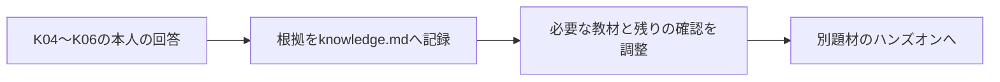

# d_01：残りの必要知識の確認、その1

K02の出力予想とK03の説明は確認済みです。K01の要学習に対応する[bytes・strの解説](guide/01-bytes-and-text.md)を用意しました。ここではCSVなどの未確認項目を別題材の3問で確認します。合否は付けません。

| ID | 確認すること | 回答するもの |
|---|---|---|
| K04 | CSVの行・列と引用符 | 出力2行と、その理由を1文 |
| K05 | 読み取り後の値の解釈 | 出力1行、読み取り後のitemが文字列か数値か、理由を1文 |
| K06 | ファイルに似たオブジェクトの読み取り | 出力2行と、その理由を1文 |

## 目次

- [答え方](#答え方)

- [K04](#k04)

- [K05](#k05)

- [K06](#k06)

- [次の段階](#次の段階)

- [用語](#用語)

## 答え方

`nodes.md` の末尾へK04〜K06として追記するか、チャットで番号を付けて回答してください。分からない場合は、その項目に「分からない」と書けます。今までの回答は書き直し不要です。

予想だけで回答できます。実行や資料参照をした場合は、本人が `submit/notes.md` に入力・操作・参照先・結果を残し、予想と実測を区別してください。解説の任意の確認を実行することは、この3問の回答条件ではありません。

## K04

次のコードの出力2行を予想し、行・列の数え方の理由を1文で説明してください。

```python
# AI担当：観測メモを使う知識確認のコード。本番の解答ではない。
import csv
from io import StringIO

rows = list(csv.reader(StringIO('station,note\nA,"cool, windy"\n')))
print(len(rows))
print(len(rows[1]))
```

## K05

次のコードの出力1行を予想してください。読み取り後の `item` が文字列か数値かも答え、その理由を1文で説明してください。

```python
# AI担当：小さな物品記録を使う知識確認のコード。本番の解答ではない。
from io import StringIO
import pandas as pd

frame = pd.read_csv(StringIO("item,quantity\n004,2\n"))
print(frame.loc[0, "item"])
```

検証環境のpandasは3.1.1です。読み込み方を変更するコードや本番の設計判断は求めていません。

## K06

次のコードの出力2行を予想し、理由を1文で説明してください。

```python
# AI担当：短い観察メモを使う知識確認のコード。本番の解答ではない。
from io import BytesIO

source = BytesIO(b"sun")
print(source.read())
print(source.read())
```

## 次の段階



問題のコードはAIがPython 3.12.0で実行確認済みです。答えは掲載していません。未回答を未学習や不合格として扱わず、教材の分量を調整する材料にします。ハンズオン・白紙の仕様と採点表は、まだ公開していません。

## 用語

| 用語 | 平易な説明 |
|---|---|
| ヘッダー | 列名などを並べた先頭の行 |
| 予想 | 実行する前に考えた結果 |
| 実測 | 実際に実行して得られた結果 |
