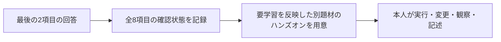

# d_01：知識確認の第3回（最終回）

2026-11-16、K07・K08を受領し、全8項目の回答が揃いました。[確認記録](feedback/knowledge_04.md)を残し、[ハンズオン](guide/handson.md)へ進みます。追加の知識確認と、この回答の書き直しはありません。以下は公開時の問題を保持しています。

知識確認は予告したK01〜K08の全8項目です。K01〜K06は受領済みで、今回は残るK07・K08の2項目だけを確認します。採点はしません。分からない場合はそのまま回答できます。

| ID | 確認すること | 回答するもの |
|---|---|---|
| K07 | 例外が起きた時の処理の流れ | 表示される内容と、最後のprintまで進むかの理由1文 |
| K08 | 同じセッションでの状態の保持 | 指定操作後の表示と理由1〜2文 |

## 目次

- [答え方](#答え方)

- [K07](#k07)

- [K08](#k08)

- [その後](#その後)

- [用語](#用語)

## 答え方

`nodes.md` の末尾へK07・K08として追記するか、チャットで番号を付けて回答してください。これまでの回答は書き直し不要です。コードの修正は求めません。

予想だけで回答できます。資料を参照したり実行した場合は、本人が `submit/notes.md` に参照・入力・操作・結果を残し、予想と実測を区別します。

## K07

次のコードでは何が表示されますか。最後の `print("done")` まで進むかについても、理由を1文で説明してください。

```python
# AI担当：数量入力を使う知識確認の別題材コード。本番の解答ではない。
try:
    amount = int("two")
    print(amount)
except ValueError:
    print("invalid")
print("done")
```

## K08

次のStreamlitアプリを開き、同じブラウザタブで `Visit` を押し、処理が終わってからもう一度押したとします。2回目の操作後の表示と、その理由を1〜2文で説明してください。途中でページの再読み込みやセッションの切断はしない前提です。

```python
# AI担当：訪問数を使う知識確認の別題材コード。本番の解答ではない。
import streamlit as st

if "visits" not in st.session_state:
    st.session_state["visits"] = 0

if st.button("Visit"):
    st.session_state["visits"] += 1

st.write(st.session_state["visits"])
```

## その後



両方の問題は2026-11-14にAIがPython 3.12.0で実行確認しました。K08はStreamlit 1.67.0のAppTestで初期表示と2回の操作を確認しています。問題の解答や本人の観察結果は掲載していません。Snowflakeへの接続や課金操作はしていません。

## 用語

| 用語 | 平易な説明 |
|---|---|
| 例外 | 実行中に通常の処理を続けられないことを知らせる仕組み |
| セッション | 利用者の一連の接続・操作を区別する単位 |
