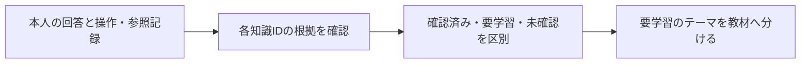

# d_01の必要知識と確認状況

2026-11-13、初回提出a9228bfとK02の追記9b0aa3eを受領しました。K01は要学習、K02・K03は今回の問題の範囲で確認済みです。K01の解説を用意しましたが、読了や学習後の理解は未確認です。次は未確認のK04〜K06を少数の問題で確認します。自己申告や過去作品内の技法を習得済みの根拠にはしていません。

## 目次

- [必要知識](#必要知識)

- [更新のしかた](#更新のしかた)

## 必要知識

| ID | 必要知識 | 必要になる操作 | 状態 | 根拠 | 参照文書 |
|---|---|---|---|---|---|
| K01 | bytesとstr、型名と__name__ | ファイルから受け取った内容を扱う | 要学習 | nodes.md 10〜17行：bytesをstrとする説明があり、__name__は知らないと申告 | [本人の回答](nodes.md)、[解説](guide/01-bytes-and-text.md)、[確認記録](feedback/knowledge_01.md) |
| K02 | 空文字・文字列・Noneの区別 | 欠けた値と文字として入った値を区別する | 確認済み（今回の問題） | 9b0aa3eのnodes.md 27〜32行に区別の説明と正しい出力予想あり。CSV・pandasの欠けた値の扱い全般は未確認 | [本人の回答](nodes.md)、[追記確認](feedback/knowledge_02.md) |
| K03 | 操作時の実行順と通常変数 | 表示操作後の処理を説明する | 確認済み（この問題の説明） | 初回提出a9228bfのnodes.md 43行：2回目の表示と、再実行のたびにcountを初期化する理由が整合。実操作の記録ではなく記述回答として確認 | [本人の回答](nodes.md)、[問題K03](README.md#k03) |
| K04 | CSVの行・列・ヘッダー・引用符 | カンマを含む値などを読み取る | 未確認 | 次の確認を公開、回答待ち | [問題K04](knowledge-check-02.md#k04) |
| K05 | 型推論と欠けた値の解釈 | 読み取り前後の値を確認する | 未確認 | 型推論について次の確認を公開。欠けた値の解釈は別途確認 | [問題K05](knowledge-check-02.md#k05) |
| K06 | ファイルに似たオブジェクトと読み取り位置 | 同じ入力を読み直す | 未確認 | 次の確認を公開、回答待ち | [問題K06](knowledge-check-02.md#k06) |
| K07 | 例外と利用者へのエラー表示 | 読めない入力の扱いを説明する | 未確認 | 後続の確認で扱う | [手順の下書き](drafts/handson-plan.md) |
| K08 | Session Stateと表示の状態 | 保持する情報を説明する | 未確認 | 後続の確認で扱う。K03だけで習得済みにはしない | [手順の下書き](drafts/handson-plan.md) |

## 更新のしかた

本人の回答を根拠にAIが更新します。回答を代筆せず、未回答を要学習や確認済みに置き換えません。ここは課題の採点表ではありません。
