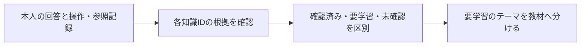

# d_01の必要知識と確認状況

2026-11-16、K07・K08の追記を12b8e79として受領し、知識確認K01〜K08は全て回答が揃いました。追加の知識確認はありません。K02・K03は今回の問題の範囲で確認済み、他の6項目は要学習としてハンズオンへ反映します。知識確認の提出が揃ったことと、学習後の習得の確認は区別します。
## 目次

- [必要知識](#必要知識)

- [更新のしかた](#更新のしかた)

## 必要知識

知識確認の範囲は下表のK01〜K08の8項目です。第1回3問、第2回3問、第3回2項目として受領済みです。初回の案内でこの全体を明示できていなかったため、READMEへ範囲を追記しました。新しい分野を追加する場合は先に本人と範囲を相談します。未確認や要学習を、追試や不合格として扱うことはありません。

| ID | 必要知識 | 必要になる操作 | 状態 | 根拠 | 参照文書 |
|---|---|---|---|---|---|
| K01 | bytesとstr、型名と__name__ | ファイルから受け取った内容を扱う | 要学習 | nodes.md 10〜17行：bytesをstrとする説明があり、__name__は知らないと申告 | [本人の回答](nodes.md)、[解説](guide/01-bytes-and-text.md)、[確認記録](feedback/knowledge_01.md) |
| K02 | 空文字・文字列・Noneの区別 | 欠けた値と文字として入った値を区別する | 確認済み（今回の問題） | 9b0aa3eのnodes.md 27〜32行に区別の説明と正しい出力予想あり。CSV・pandasの欠けた値の扱い全般は未確認 | [本人の回答](nodes.md)、[追記確認](feedback/knowledge_02.md) |
| K03 | 操作時の実行順と通常変数 | 表示操作後の処理を説明する | 確認済み（この問題の説明） | 初回提出a9228bfのnodes.md 43行：2回目の表示と、再実行のたびにcountを初期化する理由が整合。実操作の記録ではなく記述回答として確認 | [本人の回答](nodes.md)、[問題K03](README.md#k03) |
| K04 | CSVの行・列・ヘッダー・引用符 | カンマを含む値などを読み取る | 要学習 | ac89473のK04：行数の予想は合うが、読み取り後の行を元の文字列として数えている | [回答確認](feedback/knowledge_03.md)、[解説](guide/02-csv-rows-and-fields.md) |
| K05 | 型推論と欠けた値の解釈 | 読み取り前後の値を確認する | 要学習（セルと型推論） | ac89473のK05：1セルを1行分のリストと予想し、数値への型推論を説明できていない。pandasの欠けた値の解釈は未確認 | [回答確認](feedback/knowledge_03.md)、[解説](guide/03-dataframe-and-inference.md) |
| K06 | ファイルに似たオブジェクトと読み取り位置 | 同じ入力を読み直す | 要学習 | ac89473のK06：繰り返したreadも同じ内容を返すと予想。位置が末尾へ進むことの整理が必要 | [回答確認](feedback/knowledge_03.md)、[解説](guide/04-reading-position.md) |
| K07 | 例外と利用者へのエラー表示 | 読めない入力の扱いを説明する | 要学習 | 12b8e79のK07：変換失敗は分かるが、exceptを例外発生の位置とし、処理後に継続しないと説明 | [回答確認](feedback/knowledge_04.md)、[解説](guide/05-exceptions.md) |
| K08 | Session Stateと表示の状態 | 保持する情報を説明する | 要学習 | 12b8e79のK08：キーによる初期化と別タブの説明はあるが、同じタブの問題に別セッションの結果を当てはめている | [回答確認](feedback/knowledge_04.md)、[解説](guide/06-reruns-and-state.md) |

## 更新のしかた

次はハンズオンの操作と記述を根拠に学習後の状態を確認します。本人の回答を根拠にAIが更新します。回答を代筆せず、未回答を要学習や確認済みに置き換えません。ここは課題の採点表ではありません。
