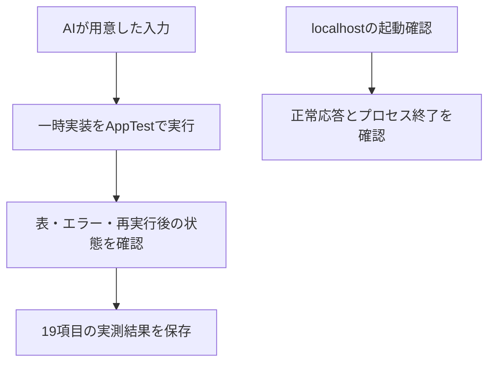

# d_01の技術検証

実施者はAI、実施日は2026-11-13（日本時間）です。本人の操作や理解を確認した結果ではありません。本番の完成コードを置かず、一時領域で必要な入力と表示の実現性を確認しました。

## 目次

- [環境と入力](#環境と入力)

- [実行と結果](#実行と結果)

- [確認した範囲](#確認した範囲)

- [依存と根拠](#依存と根拠)

- [未確認](#未確認)

- [用語](#用語)

## 環境と入力

| 項目 | 実測または実際の入力 |
|---|---|
| OS | macOS 26.6.2、ビルド25G83 |
| Python | 既存の `/usr/local/bin/python3`、3.12.0 |
| パッケージ管理 | uv 0.13.7 |
| 直接依存 | Streamlit 1.67.0、pandas 3.1.1 |
| 仮想環境 | `/private/tmp/muscle-csv-verify/.venv` |
| 入力 | AIが作った架空のCSVのバイト列。2列または3列で、文字列、空欄、引用符、改行、ヘッダーや列数の不備を含む |
| 一時コード | `/private/tmp/muscle-csv-verify/preview_probe.py` と `verify_probe.py`。本番・教材・本人の解答として配布しない |
| クラウド | Snowflakeや有料APIは未接続。課金操作なし |

## 実行と結果

| 実行・操作 | 実際の結果 |
|---|---|
| `UV_CACHE_DIR=/private/tmp/muscle-csv-uv-cache uv venv --no-config --python /usr/local/bin/python3 /private/tmp/muscle-csv-verify/.venv` | 独立環境を作成 |
| `uv pip compile --python-version 3.12 --generate-hashes` による一時依存一覧の作成 | 33パッケージを解決。実際の実行では一時入力ファイル・出力パスとPyPIのURLも指定 |
| 一時環境へ `uv pip sync --require-hashes` | 固定した33パッケージを導入。既存Python環境は変更しない |
| `STREAMLIT_BROWSER_GATHER_USAGE_STATS=false /private/tmp/muscle-csv-verify/.venv/bin/python /private/tmp/muscle-csv-verify/verify_probe.py` | 終了コード0、`passed: 19` |
| 一時アプリを `python -m streamlit run` で127.0.0.1:18543に限定して起動 | `/_stcore/health` はHTTP 200、本文 `ok`。プロセスの終了まで確認 |
| 診断用の別のカウンターをAppTestで実行 | 初期表示と2回のクリックの動作を確認。解答は問題文に掲載しない |
| 固定33パッケージの名前と版をOSVに照会 | 該当する情報の返却0件。公開されていない脆弱性や将来の状態は確認対象外 |
| プロジェクトの `.venv` に固定依存をオフラインで再現し、同じ検証を実行 | 19項目が再度PASS。版は1.67.0・3.1.1で一致 |
| `uv pip check --python .venv/bin/python` | 33パッケージを確認し、`All installed packages are compatible` |

検証コマンドではuvのキャッシュを一時領域に指定し、パッケージの取得先は公開PyPIを明示しました。AppTestの起動時に `missing ScriptRunContext` の警告が出ましたが、テスト対象アプリに未処理例外はなく、19項目の検証は終了コード0で完了しています。

## 確認した範囲

機械可読の実測結果は[verification-results.json](verification-results.json)です。画面操作はAppTestで模擬し、実ブラウザで人がクリックした結果とは区別しています。

| 番号 | 入力または操作 | 検証したこと | 結果 |
|---|---|---|---|
| 1 | ファイル未選択 | 案内を表示し、表を出さない | PASS |
| 2 | 先頭ゼロ、引用符内カンマ、空欄、文字列NA | 入力されたセル値を維持した表になる | PASS |
| 3 | 同じ正常入力を別の方法で読む | 標準csvを使う経路とpandasの経路でセル値が一致 | PASS |
| 4 | UTF-8 BOMあり | 先頭の列名とセル値を確認 | PASS |
| 5 | 日本語 | 対象の文字を保持 | PASS |
| 6 | 引用符内の改行 | 一つのセルの内容として扱える | PASS |
| 7 | CRLF | 行とセルの内容を確認 | PASS |
| 8 | ヘッダーのみ | データ0行の表として扱える | PASS |
| 9 | 0バイト | エラー1件、表0件、未処理例外なし | PASS |
| 10 | 空の列名 | エラー1件、表0件、未処理例外なし | PASS |
| 11 | 重複した列名 | エラー1件、表0件、未処理例外なし | PASS |
| 12 | 列数不足 | エラー1件、表0件、未処理例外なし | PASS |
| 13 | 列数超過 | エラー1件、表0件、未処理例外なし | PASS |
| 14 | 閉じていない引用符 | エラー1件、表0件、未処理例外なし | PASS |
| 15 | 非UTF-8 | 今回の入力範囲ではエラーとして扱える | PASS |
| 16 | 表示用チェックボックスの操作 | 再実行後も同じセル値を確認できる | PASS |
| 17 | 別の正常ファイルへ差し替え | 新しい入力だけが表示される | PASS |
| 18 | 正常入力から不正入力へ差し替え | 古い表を出さず、エラーを表示 | PASS |
| 19 | ファイル選択の解除 | 表を出さず案内に戻る | PASS |

これは実現性の確認であり、本人へ出した本番の仕様・採点基準ではありません。全ての境界をそのまま最初の白紙課題へ追加する決定ではありません。白紙の具体的な条件は、学んだ範囲で後に公開します。



## 依存と根拠

課題ブランチのルートに、直接依存を記した `requirements.in` と、全33パッケージの版・ハッシュを記した `requirements.lock` を置きます。検証で使った固定結果を保存したものです。

導入したパッケージのメタデータで、StreamlitはApache-2.0、pandasはBSD-3-Clause、どちらもPython 3.11以上を要件とすることを確認しました。公式アドバイザリも閲覧しました。OSVへの照会で送ったものは公開パッケージ名と版だけです。

参考にした公式情報（2026-11-13確認）：

- [Streamlitのローカル導入](https://docs.streamlit.io/get-started/installation/command-line)

- [Streamlitのファイル入力](https://docs.streamlit.io/develop/api-reference/widgets/st.file_uploader)

- [StreamlitのAppTest](https://docs.streamlit.io/develop/api-reference/app-testing/st.testing.v1.apptest)

- [Pythonのcsv](https://docs.python.org/3.12/library/csv.html)

- [pandasのread_csv](https://pandas.pydata.org/docs/reference/api/pandas.read_csv.html)

- [uvの依存固定](https://docs.astral.sh/uv/pip/compile/)

- [Streamlitのアドバイザリ](https://github.com/streamlit/streamlit/security/advisories)

- [pandasのアドバイザリ](https://github.com/pandas-dev/pandas/security/advisories)

- [OSVの照会API](https://google.github.io/osv.dev/post-v1-querybatch/)

## 解説と追加確認の実測

2026-11-13、プロジェクトの `.venv/bin/python`（Python 3.12.0）で、[bytes・strの解説](guide/01-bytes-and-text.md)の例を実行した。海の型名、文字とUTF-8のバイトの長さ、バイト表現、復号、型オブジェクトと型の名前を確認し、解説の実測欄へ出力を記載した。別入力sky・空文字・空についてUTF-8変換の往復も確認した。本人の観察結果ではない。

[追加の知識確認](knowledge-check-02.md)のK04〜K06のコードも同じ環境で実行確認した。K05のpandasは3.1.1。問題の出力の解答は掲載せず、未回答の状態を保持している。新たな依存の追加、Snowflakeへの接続、課金操作は行っていない。

## 2026-11-14の回答確認と解説の実測

実行場所はこのプロジェクトのルート、コマンドは `.venv/bin/python` に検証コードをヒアドキュメントで渡す方法。Python 3.12.0、pandas 3.1.1でK04〜K06の公開コードを実行した。

| 対象 | AIの実測 |
|---|---|
| K04 | len(rows)とlen(rows[1])は2と2。rows[1]は2フィールドのリスト |
| K05 | セルの表示は数値4、型はnumpy.int64。DataFrameの形は1行2列 |
| K06 | readの結果はbytesの内容、続いて空のbytes。位置は3 |
| CSVの別題材 | 引用符内のカンマを含む2フィールドを確認。newline空文字の経路でLF・CRLF・CRも確認 |
| DataFrameの別題材 | 型指定なしで番号が数値、列の型指定ありで先頭ゼロを含む文字列になること、1行と1セルの違いを確認 |
| BytesIOの別題材 | 部分読み、残りの読み取り、末尾からの読み取り、seekとgetvalueを確認 |

最後の診断K07はPython 3.12.0、K08はStreamlit 1.67.0のAppTestで実行確認した。K08は初期表示と同一セッションの2回の操作を確認。未回答のK07・K08の出力は資料へ掲載しない。新たな依存の追加、Snowflakeへの接続、課金操作はしていない。

## 2026-11-16の教材の実測

K07・K08の回答を受領し、公開コードをPython 3.12.0、Streamlit 1.67.0で再実行した。K07はinvalidとdone、K08の同一セッションの2回目は2という結果。本人の回答の修正は行わず、要学習を記録した。

別題材のCLI・画面教材を作成し、次のコマンドで実行検証した。実行場所はこのプロジェクトのルート、依存は既存の固定環境で、追加導入なし。

```sh
# AI担当：公開前の教材を一時領域の検証コードで実行する操作。
STREAMLIT_BROWSER_GATHER_USAGE_STATS=false .venv/bin/python /private/tmp/d01-handson-20261116/verify.py
```

終了コード0、[13項目の実測記録](handson-verification.json)は全てPASS。正常・指定した変更・必要な失敗時に加え、指定外の境界も確認した。追加境界を本人の採点要件にはしていない。

| 対象 | 実際の確認 |
|---|---|
| CLI | 文字とバイト、CSVの行・フィールド、型推論、先頭ゼロ・空欄・文字列NA・0を確認 |
| CLIの変更操作 | 指定した2か所を一時コピーで変更して実行。元の教材は公開時の値のまま保持 |
| CLIの追加境界 | 読む量0、末尾を超える量でも読み直しの結果が保たれることを確認 |
| 画面 | 未選択、教材メモの選択、同じセッションの連続操作、不正入力時のエラーと後続の表示を確認 |
| 画面の変更操作 | 一時コピーの初期値を変更し、既存キーの保持、Reset、変更後の操作、新規セッションを確認 |
| 画面の追加境界 | ファイル選択解除、増分0を確認 |
| localhost | 教材を127.0.0.1:18501で起動。healthはHTTP 200・本文ok。検証後にプロセス停止を確認 |
| 本人の観察 | まだ未提出。AIの実測を本人のnotes.mdやanswers.mdへ転記していない |

教材コードを変えた検証は一時コピーで行い、本人が行う変更・操作の結果をsubmitへ代筆していない。ハンズオンの公開条件はS01・S02・W01に固定した。白紙仕様と採点表はまだ作っていない。

解説の追加例もPython 3.12.0で実行した。pandas 3.1.1の欠損値の例は、既定で2セルとも欠損判定され、指定を変えた経路では文字列NAと空文字が保持された。公式資料は2026-11-16に[Pythonの例外処理](https://docs.python.org/3.12/tutorial/errors.html#handling-exceptions)、[Session State](https://docs.streamlit.io/develop/api-reference/caching-and-state/st.session_state)、[ファイル入力](https://docs.streamlit.io/develop/api-reference/widgets/st.file_uploader)を確認した。

## 未確認

| 対象 | いつ確認するか | 誰が何を実行するか |
|---|---|---|
| 本人の学習後の理解 | ハンズオンの完了・提出後 | 本人の操作・観察・説明を公開済みのS01・S02・W01で確認。全8項目の初回回答は受領済み |
| 実ブラウザからのファイル選択と表示 | ハンズオン公開後 | 本人が教材と指定入力を動かして観察し、記録を提出 |
| 本人の教材の操作と変更 | ハンズオンの提出後 | AIは公開前13項目を確認済み。本人の実操作と変更後の提出を別に確認 |
| Excel、2ファイルの照合 | その機能を扱う回 | AIが指定環境で正常・境界・失敗時を検証 |
| Snowflake・dbt | その機能を扱う回 | 本人と無料トライアルの残高・期限を再確認し、AIが必要最小限で別途検証 |
| 本人が書く本番の部品 | 白紙実装の提出後 | AIが公開済み条件で実行し、既存の部品との接続も確認 |

未確認を、動作した・理解した・課題が完了したという記録に置き換えません。

## 用語

| 用語 | 平易な説明 |
|---|---|
| AppTest | ブラウザの代わりにPythonから画面操作と表示を調べるStreamlitの仕組み |
| 一時実装 | 実現性だけを確認するために別の場所に置いた実装 |
| ハッシュ | 導入するファイルの内容が固定結果と一致するか確かめる値 |
